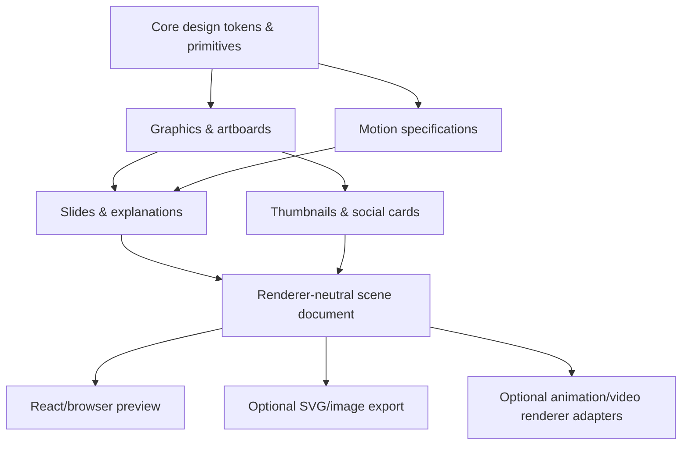

# 07 — Content Graphics, Slides, Animation & Video Components

**Scope:** reusable, editable visual building blocks for articles, infographics, slides, explanatory videos, social graphics and thumbnails. **Same `kumiki-ui` repository**, selectively installed as registry items. Not a video editor, image model, codec, TTS engine, publishing platform or second component library.

## Architecture and ownership



- **Presentation components** define layout and editability. **Scene documents** encode content, timing, assets and intent. **Renderer adapters** implement playback/export. These are related but not interchangeable code.
- Never assume a React DOM component can be dropped into Motion Canvas or any other renderer. Reuse the document, tokens and semantic geometry; write engine-specific interpreters as needed.
- Install media items individually (`artboard`, `slide-deck`, `kinetic-title`, `thumbnail-layout`, etc.) through the existing GitHub registry. Grouping below describes architecture, **not mandatory npm packages**.
- Every component must work in a normal React preview without installing FFmpeg, a diffusion model, a video encoder, 3D libraries or a heavyweight renderer. Optional adapters declare optional peer/runtime dependencies.
- Reuse assets through references, not copies; content remains user-owned and portable in JSON + SVG/PNG/other documented formats.

## Definitive content-component inventory

The existing **15 v0.1 UI components remain unchanged**. Media features are subsequent **optional tracks**, not prerequisites for a button or dialog.

### Track M0 — Graphic composition foundation (implement first)

| Registry item | Core behavior / design contract | Result |
|---|---|---|
| `artboard` | Configurable dimensions, background, bleed/safe area, zoom, pan; stable coordinate system; never alter source asset dimensions | Editable visual stage |
| `layer-stack` | Explicit z-order, visibility, opacity, locking, clipping; names; avoid accidental overlays | Deterministic composition |
| `editable-text` | Rich text ranges, font fallback, wrapping, fit policy, editable source; Unicode/IME; intrinsic text measurements | Reusable typographic layer |
| `media-frame` | Image/video/illustration slots, fit/fill, object position, aspect ratio, mask, accessible description | Reusable asset layer |
| `alignment-guides` | Grid, guides, snapping, safe bounds, selected-element measurements; hide in final export | Authoring assistance |
| `export-preview` | Preview exact export dimensions, background, crop, file format; small-scale legibility view | Accurate QA view |

**M0 acceptance example:** compose a 16:9 hero graphic with three text layers and one image; preserve editing after save/reload; export a clean image with no guide overlays. Test 1:1, 9:16 and 16:9; Japanese/English text; light/dark editor; verify no surprise clipping.

### Track M1 — Animated explanations and slides

| Registry item | Core behavior / contract | Use |
|---|---|---|
| `slide-deck` / `slide` | Ordered scenes, slide backgrounds, section labels, duration, editable content, aspect presets; navigation | Slideshows, slide-to-video |
| `slide-transition` | Cut, fade, slide, wipe; bounded/interruptible parameters; reduced-motion equivalent | Scene continuity |
| `animated-text` | Word/line/character entrance where readable; reveal masks, text emphasis; deterministic timing | Kinetic typography |
| `motion-track` / `keyframe-editor` | Typed properties, keyframes, easing, sequencing, preview scrubbing; no time-dependent hidden randomness | Authoring animations |
| `progressive-reveal` | Reveal complex diagrams step by step with semantic groups; narration cue optional | Explaining difficult concepts |
| `diagram-stage` | Nodes, connectors, labels, grouping and auto-layout adapter; editable relationships; accessible text summary | Architecture/process visuals |
| `callout-focus` | Highlight/spotlight/arrow/zoom callouts; explicit focus target, safe layout | Tutorials & demos |
| `compare-reveal` | Before/after, side-by-side, state change; aligned and labelled | Comparisons |
| `chart-reveal` | Typed chart data + staged series/annotation reveal, sensible axes, alt summary | Data-driven explanations |
| `camera-pan-zoom` | Pan/zoom over still assets without distorting them; safe focal region | Slideshow motion / Ken Burns |

**M1 acceptance example:** a six-slide, 45-second explanation using progressive diagrams, narration cues and moving highlights. Exports and editor seek should resolve to the **same composition at frame N**, independent of rendering order. Avoid gratuitous effects; transitions must support cuts and reduced motion.

### Track M2 — Video, captions, characters and thumbnails

| Registry item | Core behavior / contract | Use |
|---|---|---|
| `video-composition` | Scenes/tracks, FPS, timing, asset URLs, deterministic seek, in/out markers | Scripted videos |
| `timeline-editor` | Tracks, trimming, snapping, dragging with keyboard alternative, markers, audio waveforms via optional provider | Edit scenes without rerendering all |
| `caption-overlay` | Segments/words, language, typography, position, contrast backplate, timing, safe-area collision rules | Subtitles and Shorts |
| `character-presenter` | Stable `characterId` + approved asset/rig reference, expression, pose, mouth cues; **no identity generation** | Repeatable educational presenters |
| `scene-storyboard` | Scene thumbnails, visual objective, on-screen text, narration cue, preview and reorder | Explanation planning |
| `thumbnail-canvas` | 16:9, 9:16, 1:1 presets, editable text/image layers, character and subject focus, safe-zone overlays | Video thumbnails & social cards |
| `thumbnail-variants` | Linked A/B design variants and side-by-side scaled previews; preserve editable source and experiment labels | Thumbnail optimization |
| `subject-cutout` | Accepts transparent raster/vector asset and optional mask; extraction model remains external | Character/product prominence |

**M2 acceptance examples:** (a) 60-second narrated explainers with captions synchronized to scene/word timing, (b) a thumbnail edited from three text/subject variations, tested at 320px-wide and 160px-wide previews; no overlaid YouTube chrome assumed to be universal.

### Later, only with evidence of demand

Waveform editor, node-based animation graph, 3D scenes, keyframe curves editor, on-canvas pen/drawing tools, video masks/rotoscoping, puppet rig editor, automatic lip sync, AI image/video generation, real-time collaboration and platform uploaders are **not** Kumiki core primitives. They can be adapters, consumer features or future isolated components. Build them only after M0–M2 succeeds.

## Renderer-neutral scene contract (v0 proposal)

Kumiki owns **a schema**, not a video renderer. All times are integer **frames** at a declared FPS; preview and export must evaluate `renderAt(frame)` deterministically. Use stable IDs so individual layers/scenes can be regenerated without changing the rest. Content authoring can convert seconds to frames, but scene storage never relies on accumulated floating-point seconds.

```ts
interface Composition {
  schemaVersion: 1;
  id: string;
  canvas: { width: number; height: number; fps: number; background: string };
  tokenTheme?: string; // consumer-provided theme name, no brand assumptions
  assets: Record<string, { uri: string; mediaType: string; hash?: string }>;
  scenes: Array<{
    id: string; startFrame: number; durationFrames: number;
    layers: Array<{
      id: string;
      kind: 'text' | 'image' | 'shape' | 'diagram' | 'character' | 'caption';
      assetRef?: string; content?: unknown;
      transform: { x: number; y: number; width: number; height: number; rotation?: number };
      order: number; overlapPolicy?: 'avoid' | 'explicit-layer';
      animation?: Array<{ property: string; keyframes: Array<{ frame: number; value: unknown; easing?: string }> }>;
    }>;
    narration?: { assetRef: string; startFrame: number; transcript?: string };
  }>;
}
```

This is a **proposed contract**, not an implemented API. Freeze it only after a prototype proves: JSON round-trip, renderer-independent preview/export equivalence, Unicode, text measurement, seek fidelity and stable asset handling. Use relative coordinates or responsive constraints in authoring; the example uses absolute design-space coordinates for reproducible export. Schema migrations must be versioned and testable.

Never embed executable JS, unsandboxed network actions or model prompts as runnable code within composition documents. URL/file assets are explicitly validated by the consumer; no untrusted remote fetch by default.

## Design rules for premium media

- **Explanation before decoration.** Every visual must communicate an idea, contrast, relationship, action or emotional tone. Decorative motion cannot steal attention from the lesson.
- **One focal point at a time.** Hierarchy controls text/image emphasis and pacing; use reveal staging for dense diagrams instead of shrinking text.
- **Typography stays editable.** Use real font measurements and locale-aware line breaking; fonts must have explicit rights metadata and fallback strategies. Don't bake explanatory text into generated pictures.
- **Shared tokens, separate art direction.** Consume color, spacing, type and motion roles from Kumiki; creative compositions may override semantic roles without weakening contrast or breaking layout.
- **Default safe bounds:** start at ~5% inset for desktop video composition, adjustable by format and content. Treat this as an editorial heuristic, **not a platform guarantee**. Account for user-configured captions/controls/overlays.
- **Avoid text overload:** keep slides readable at final display size and inspect downscaled previews; split complex content into multiple scenes rather than fitting every sentence onto a frame.
- **Motion has meaning:** reveals direct attention; camera movement adds context; easing is consistent; scenes should be comprehensible when motion is reduced.
- **Deterministic stills:** graphic and thumbnail exports should be editable SVG/scene JSON first, then generated raster formats. Every graphic can be recreated from its document and pinned assets.
- **Character consistency:** presenter layers consume approved character identities/assets; generative models do not silently replace approved reference artwork.

## Validation gates — content-specific

| Defect | Deterministic detection | Review / fallback |
|---|---|---|
| Off-canvas text, cropped headlines, unintended overlaps | Bounding-box + rendered pixel checks at chosen frame; known exclusion masks | Human review for intended art-direction overlaps |
| Unsafe margins and icon/label occlusion | Safe-area polygon checks, designated caption and platform-overlay exclusion zones | Context-sensitive override with written reason |
| Text too small at delivery size | Font metrics + previews at full target and small mobile widths | Human legibility assessment, especially CJK |
| Poor contrast on images | Text contrast/backplate measurement over rendered background samples | Check variable backgrounds/motion, not one still |
| Animation hides information | Keyframe/end-state visibility checks; minimum dwell-time rules | Educational comprehension review |
| Stutter, nondeterministic frames | Frame-by-frame snapshots at keyframes/midpoints, fixed fonts/assets/clock | Target-browser/render tests |
| Narration/video timing mismatch | Scene duration vs supplied audio/transcript timing | Optional STT comparison via consumer adapter |
| Caption collision | Caption bounds vs essential focus targets over time | Style/layout adjustment or reposition |
| Generated thumbnail confusing at small size | Downsampled preview, OCR-independent geometry and text metrics | Editorial review of subject focus and meaning |

For a scene, sample **first, last, each keyframe, each transition boundary, and representative tween frames**; catch intermediate extrema and dynamic collisions. Document that sampling does not mathematically prove every frame is collision-free. Automated detectors must include intentionally broken fixtures for overlap, clipping, under-contrast, margin violations, Japanese glyph fallback, and subtitle occlusion. Treat QA failures as actionable layer IDs + timestamps + screenshots.

## Optional tool integrations (not shipped by default)

| Integration | What it provides | Important boundary |
|---|---|---|
| [Motion](https://github.com/motiondivision/motion) | DOM/React interactions, shared layout and transitions | **Preview motion != offline video export**; create a deterministic adapter |
| [Motion Canvas](https://github.com/motion-canvas/motion-canvas) | Programmatic informative vector animations and voiceover synchronization | Its scene graph is different from React DOM; adapter required; MIT |
| [Remotion](https://www.remotion.dev/docs/license) | React video composition/export | Optional; eligibility-based license terms; do not include as default dependency |
| [Satori](https://github.com/vercel/satori) | Static JSX-like layout → SVG for thumbnails/social cards | Static subset, not interactive React or video; MPL-2.0 |
| [resvg](https://github.com/linebender/resvg) | Static SVG → raster image, Rust-friendly | Does not animate SVG; MIT/Apache-2.0 |
| [ELK.js](https://github.com/kieler/elkjs) | Layout for node-edge diagrams | Computes positions; doesn't draw or animate |
| [dotLottie Web](https://github.com/LottieFiles/dotlottie-web) | Playback of existing Lottie animations | Player, not full timeline authoring or a general video exporter |
| Browser capture / Playwright | Deterministic screenshots of rendered content | Actual fonts/environment must be pinned |

Before writing an adapter: verify current license and redistributability, browser/headless compatibility, export reproducibility, memory/build cost, and accessibility. Do not make optional integrations transitive dependencies for `Button` or `ThumbnailCanvas`.

## Small verified implementation slices

1. **M0-A:** `artboard` + `editable-text` + `media-frame`; build a branded-neutral 16:9 explanatory image and a 9:16 title card, with exact export preview.
2. **M0-B:** `layer-stack` + `alignment-guides` + `export-preview`; prove layout QA and JSON round-trip in a clean consumer.
3. **M1-A:** `slide-deck` + `slide-transition` + `animated-text`; produce five slides with purposeful text reveals and reduced-motion alternative.
4. **M1-B:** `progressive-reveal` + `diagram-stage` + `callout-focus`; render a 30–60s technical explainer; export only through an explicitly installed adapter.
5. **M2-A:** `thumbnail-canvas` + `thumbnail-variants` + `subject-cutout`; create three editable variants, show mobile-size previews, verify text/margin QA.
6. **M2-B:** `video-composition` + `caption-overlay` + `scene-storyboard`, followed by `timeline-editor`/`character-presenter` when justified. Validate actual narration/caption synchronization and frame geometry.

**Quality over inventory:** ship the small slices above with real Storybook, interaction checks, frame tests and a clean registry install; don't implement all media items in one agent session.
