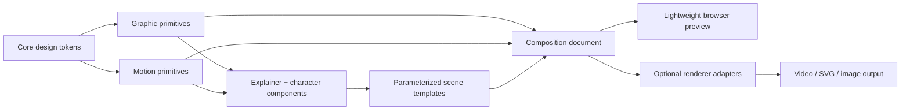

# 07 — Media Foundation

**Status:** proposed contracts; not an implementation claim. **Scope:** reusable, code-first media components within **`kumiki-ui`**, distributed as individually installable registry items. **Audience:** implementers, AI coding agents, and applications generating diagrams, slides, explainers, thumbnails, and video scenes.

## 1. Boundary and ownership

Kumiki provides **editable visual primitives**, **typed motion descriptions**, **composable explanation/character components**, **parameterized templates**, and a **renderer-neutral composition document**. Consumers provide content, scripts, assets, voice generation, scheduling, export infrastructure, and publishing. Renderers execute scenes; Kumiki is **not** a video editor, TTS service, codec, image/video generation model, or upload platform. Retain the existing 15 v0.1 UI components unchanged. Media components are optional, not dependencies of ordinary UI.



| Layer | Owns | Must not own |
|---|---|---|
| Tokens | Colors, typography roles, spacing, motion roles, visual treatments | Brand-specific creative direction |
| Primitives | Artboard, text, path, groups, animation, masks | Lesson-specific narrative |
| Components | Data flow, animated code, title, presenter, caption | Exporter implementations |
| Templates | Parameterized story patterns and shot composition | Hard-coded scripts or proprietary assets |
| Document | Geometry, time, asset references, semantics, versioning | Executable render code |
| Adapters | Mapping document to preview/export engines; capabilities | Canonical scene semantics |
| Consumer | Story/script, TTS/STT, assets, rights, encoding, publication | Hidden changes to Kumiki contracts |

**Canonical ownership:** Component inventory and registry rules live **here**. Animation behavior lives in [08](08-motion-graphics.md); instructional components and templates in [09](09-explainer-components.md); character/audio in [10](10-character-audio.md); schema, adapters, validation and export in [11](11-rendering-quality.md). Other files reference contracts; they do not redefine them.

## 2. Component inventory and priorities

**M0: Graphic foundation — build first.**

| Registry item | Minimum useful contract |
|---|---|
| `artboard` | Explicit dimensions, stable coordinates, background, safe region, crop/bleed, aspect presets, zoom/pan for authoring only |
| `layer-stack` | Stable ID, parent/group, z-order, visibility, lock, opacity, blend and clipping where supported |
| `editable-text` | Spans, intrinsic metrics, deterministic wrap/fit policy, locale/bidi support, font fallback, text-as-text exports |
| `media-frame` | Referenced image/video/vector, fit/fill, focal point, mask, crop, alt description; never mutate source dimensions |
| `alignment-guides` | Snapping, grids, bounds and measurements; excluded from export |
| `export-preview` | Output-size preview, bleed/crop, small-format inspection, missing-font/asset warnings |

**M1: Motion and instructional composition.**

| Registry item | Minimum useful contract |
|---|---|
| `motion-track`, `motion-preset` | Typed keyframes, relative cue anchoring, deterministic evaluation; see [08](08-motion-graphics.md) |
| `slide-deck`, `slide-transition` | Ordered scenes, durations, scene transition contracts, reduced-motion alternative |
| `animated-text`, `mask-reveal`, `shape-morph` | Editable typography, track mattes, shape-compatibility validation |
| `diagram-stage`, `progressive-reveal` | Stable semantic nodes/edges, staged focus, layout-locking across updates |
| `callout-focus`, `compare-reveal`, `chart-reveal` | Legible targets, annotations, emphasis timing, typed source data |
| `camera-stage`, `shared-element-transition` | Camera targets, 2.5D depth, stable element handoff across scenes |
| `animated-code`, `data-flow`, `math-expression` | Technical explanation patterns; see [09](09-explainer-components.md) |

**M2: Full video-facing integration.**

| Registry item | Minimum useful contract |
|---|---|
| `video-composition`, `scene-storyboard` | Frame-based document and scene narrative metadata; not a full NLE |
| `caption-overlay`, `audio-cue-track` | Timed captions, safe positioning, sync metadata; see [10](10-character-audio.md) |
| `character-presenter` | Approved rig/sprite reference, layered expression/gesture/speech, deterministic pose at frame |
| `thumbnail-canvas`, `thumbnail-variants`, `subject-cutout` | Editable artwork, linked variants, small-size QA; extraction is external |
| `timeline-inspector` | Frame scrub, markers, track diagnostics, selection; full editing UI is deferred |

**Deferred until proven necessary:** node-graph editor, video trimming UI, pen tool, vector editor, full puppet-rig authoring, automatic rotoscoping/lip extraction, 3D engine, multi-user editing. These may become separate optional adapters or consumer capabilities. Avoid implementing the same feature in an editor and again in the renderer.

## 3. Shared contracts

| Concern | Required behavior |
|---|---|
| Coordinates | Scene design space uses declared pixel dimensions; origin top-left, +x right, +y down. Group transforms are local to parent. Output scaling must not alter layout decisions. |
| Time | Integer frames at declared rational FPS; subframe source-audio timestamps may be retained as source metadata but visual state resolves by frame. [11](11-rendering-quality.md) owns the schema. |
| Identity | Stable `id` for each scene/layer/node; stable `semanticId` for objects continuing across scenes. IDs are not regenerated by rerendering. |
| Assets | URI/reference plus media type, dimensions where relevant, hash, rights/provenance and font metadata. Resolution/policy is consumer-configured; no implicit network fetch. |
| Typography | Keep text editable; use measured glyph runs, controlled wrapping, locale-aware segmentation and pinned fonts. CJK, combining marks, RTL and emoji fallback require fixtures. |
| Responsiveness | Reflow **at authoring time** for 16:9, 9:16, 1:1; render is fixed-size after layout. Do not stretch a landscape frame into a vertical one. |
| Accessibility | Semantic summaries, captions/transcripts, contrast-safe focus, reduced-motion alternatives. Do not assume every graphical meaning is conveyed by color. |
| Motion | Discrete state `evaluate(frame)` with no dependence on playback history, wall time or unordered randomness. |
| Safety | Data-only documents: no arbitrary JS expressions, untrusted template execution, unrestricted asset requests or embedded prompts interpreted as commands. |
| Extensibility | Optional features advertise capabilities and graceful **explicit** fallback. Unsupported semantic content must not silently disappear. |

## 4. Registry item contract

Each registry item publishes the **smallest complete vertical slice**: source, typed props, schema fragment or scene builder, preview story, fixture, dependency manifest, tests, docs. Name registry entries by intent (`data-flow`), not renderer (`remotion-data-flow`). Renderer bindings live in optional adapter registrations.

```ts
// Illustrative authoring metadata; wire format is specified in 11.
type MediaRegistryItem = {
  name: string;                       // kebab-case, stable
  apiVersion: number;
  track: 'M0' | 'M1' | 'M2';
  kind: 'primitive' | 'component' | 'template' | 'adapter';
  requires: string[];                 // registry items, no hidden transitive toolchains
  capabilities?: string[];           // see renderer capability contract in 11
  fixtures: string[];                // reproducible scene examples
};
```

**Rule:** `artboard`, `editable-text`, `thumbnail-canvas` and standard React preview cannot require FFmpeg, a GPU API, Rive, Motion Canvas, Remotion, ML models or a 3D framework. Optional exporters must be installable and removable without modifying core component behavior. DOM/React components are **not** automatically portable to canvas scene graphs; adapters reuse semantic geometry, tokens and documents, not DOM trees.

## 5. Premium defaults, not a house style

Define design roles: `surface`, `ink`, `accent`, `muted`, `focus`, `shadow`; type roles: `display`, `heading`, `body`, `annotation`, `caption`; spacing scale; corner and stroke roles; motion roles: `reveal`, `emphasis`, `exit`, `handoff`. All values are overridable by a consumer theme. A premium result is **intentional hierarchy, legibility, continuity, restraint and predictable detail**, not maximal glow, gradients or animation.

Editorial constraints: one dominant focal action at a time; prefer staged detail over shrinking text; leave deliberate negative space; preserve object positions or animate the reason they move; avoid formulaic movement on every element. Safe region begins with a configurable ~5% inset **heuristic**, not a platform guarantee. Always inspect actual delivery format and caption/platform overlays. Specific animation grammar belongs in [08](08-motion-graphics.md).

## 6. Shipping order and stop conditions

| Slice | Deliver | Must demonstrate |
|---|---|---|
| M0-A | Artboard + editable text + media frame | Editable 16:9 and 9:16 visuals; font/asset pinning; pixel-clean raster preview |
| M0-B | Layers + guides + export preview | Save/reload round-trip, nonexporting guides, crop/overlap diagnostics |
| M1-A | Keyframe primitives + title + transitions | 30-second cohesive typographic animation with frame-accurate seeking |
| M1-B | Diagram + code + data flow + shared elements | Narrated technical explainer with concept continuity; 16:9/9:16 variants |
| M2-A | Captions + audio cues + one character mode | Talking presenter with independent mouth/blink/gesture channels |
| M2-B | Renderer adapter + thumbnails + QA | Reproducible video and editable thumbnail exports with machine-readable QA report |

A slice ships only if: an independent consumer installs its registry items; a documented code example runs; an editable JSON fixture round-trips; browser preview works with optional features disabled; preview/export parity is measured; failure diagnostics give layer IDs and frames. Ship complete examples, not placeholder APIs.

## 7. Reference production bar

Maintain three **reusable golden productions**, not dozens of superficial demos:

1. **Technical explainer (60–90 s):** code + architecture flow + zoom + shared-object handoffs + narration/captions.
2. **Character lesson (30–60 s):** sprite presenter, blinking, lip cues, pose changes, pointer gesture and sound cues.
3. **Product introduction (15–30 s):** kinetic type, mask/morph transition, premium lighting/effects, no illegible text.

For each: publish scene JSON, pinned assets, expected frames, source/target aspect ratios, known capability requirements, render command and QA output. [11](11-rendering-quality.md) defines reproducible acceptance. **Quality before inventory:** expand components only when these productions expose a genuine reusable gap.
