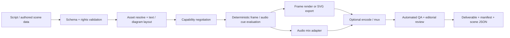

# 11 — Scene Contract, Renderer Adapters & Production QA

**Purpose:** define the **single canonical serialization and export boundary** for all media components. This document owns timing, scene composition, adapter capabilities, determinism, asset policy and quality gates. The types below are **proposed v1 baseline plus optional v2 3D extension**, not claims of implemented APIs. Prototype and revise before freezing. See [07](07-media-foundation.md), [08](08-motion-graphics.md), [09](09-explainer-components.md), [10](10-character-audio.md), [12](12-infographic-system.md), [13](13-content-creation-integrations.md).

## 1. Non-negotiable system invariants

Implemented choreography fragment **MD1 authoring v1** (`MotionDirection`,
[`contract`](component-specs/motion-director.md)) persists expanded choreography,
existing VT1 scenes and typed cue metadata. `compileMotionDirector` resolves it to
MG1 tracks, existing storyboard records and source-map diagnostics. It is not a
new Composition schema, renderer or transport. Save/recompile through
`serializeMotionDirection` / `parseMotionDirection`. Runtime interruption returns
an MG1 timeline and leaves its original authoring recipe immutable. The optional
React boundary shares one evaluation with existing 2D/3D camera and VT1 adapters.
Video, audio assets/mixing and full MD1 production qualification are not claimed.

Implemented authoring fragment **VT1** (`schemaVersion: 1`,
[`VisualTransformationSpec`](../registry/motion/visual-transformation-types.ts))
stores from/to snapshots, explicit semantic mappings, rational FPS, global
handoff range, strategy/fallback/easing and seeded particle parameters. It
compiles to MG1 and uses the host document's frame domain; it is not a competing
Composition schema. Save with serializeVisualTransformation and load/recompile
with parseVisualTransformation. Interruption programs retain immutable segment
history and exact painted C0 snapshots. The SVG adapter supports 2D contours,
text, opaque paths and rectangular clip/alpha/luma mattes; unmatched clip owners
use explicit endpoint-pose crossfade. Color is sRGB, RGB0–255/alpha0–1. No 3D,
linear-light conversion or encoded-video adapter is introduced by VT1.

1. **One document, many backends:** content, semantics, timing and assets are renderer-neutral; DOM components and canvas/scene-graph nodes need separate interpreters.
2. **Frame-addressable:** `renderAt(frame)` is pure given pinned inputs. Seeking directly to a frame cannot change output.
3. **Stable identity:** scene/layer IDs survive save/reload; `semanticId` identifies an educational object that persists across scene boundaries.
4. **Explicit fidelity:** missing fonts, effects, codecs, language shapers, character rigs and masks produce capability errors or **opted-in** documented fallbacks.
5. **No ambient dependencies:** normal React preview and image/thumbnail components do not require FFmpeg, Remotion, Motion Canvas, a GPU, ML inference or paid services.
6. **Preserve editability:** JSON stores layers, typed assets, semantic nodes, timing and constraints; export is a derivative, not the only master.
7. **Safe data:** compositions contain JSON data, never executable JS, URL fetch instructions or raw user prompts to run at render time.

## 2. Time, transforms and track evaluation

- `fps` is rational `{ num, den }`: 30 fps = `{30,1}`; ~29.97 = `{30000,1001}`. `frame` is a nonnegative integer in the composition timeline. Duration `N` covers `[startFrame, startFrame + N)`; a still at the last frame is `start + N - 1`.
- Imported speech/audio timestamps can retain original sample/timestamp precision; convert to frame boundaries **once** with a declared rounding mode (`nearest`, `floor`, `ceil`), avoiding incremental drift.
- Coordinates use artboard design pixels, top-left origin; transform order is explicit. `x`,`y` locate the layer origin in parent space, width/height are unrotated local bounds. Percent-based constraints are resolved **before** fixed-frame evaluation.
- A scene instance can be trimmed/placed multiple times, but its local time mapping is defined. Nested compositions form an **acyclic graph**; reject recursion and out-of-bounds source trims.
- Evaluation order: resolve assets/fonts → precomputed responsive layout → named cues → nested scene local time → layer animation/property conflicts → rig channels → camera/parent transforms → masks/effects → paint in explicit z-order → captions/overlays → audio mix/export. Cache expensive geometry/physics without making output order-dependent.
- At overlaps, a transition owns source/destination scene opacity and shared element handoff; **two active scenes do not implicitly double-paint the same semantic object**.

## 3. Proposed typed document (wire contract sketch)

Types intentionally exclude executable functions. Real implementation should use a runtime validator (e.g. Zod/JSON Schema), discriminated unions for each semantic component and round-trip/migration tests. `payload` is a versioned, per-`kind` JSON object validated by a **registered schema**, not arbitrary code.

```ts
// Proposed v1; exact syntax/fields subject to prototype validation.
type Frame = number; // integer >= 0; end-exclusive ranges
interface Fps { num: number; den: number } // positive integers
interface Rect { x: number; y: number; width: number; height: number }
interface Transform extends Rect {
  rotation?: number; scaleX?: number; scaleY?: number;
  anchorX?: number; anchorY?: number; depth?: number;
}
type Json = null | boolean | number | string | Json[] | { [key: string]: Json };
type Easing = 'linear' | 'ease-in-cubic' | 'ease-out-cubic' |
  'ease-in-out-cubic' | { cubicBezier: [number, number, number, number] };
type ValueType = 'number' | 'angle' | 'vec2' | 'color' | 'opacity' |
  'transform' | 'path' | 'boolean';
interface Keyframe { frame: Frame; value: Json; easing?: Easing }
interface AnimationTrack {
  targetId: string; property: string; valueType: ValueType;
  keyframes: Keyframe[]; // local to containing scene; ordered
  blend?: 'override' | 'additive'; priority?: number;
}
interface Asset {
  uri: string; mediaType: string; sha256: string;
  width?: number; height?: number; durationSamples?: number;
  licenseId?: string; attribution?: string; language?: string;
  fontFamily?: string; fontWeight?: number; rightsNote?: string;
}
interface Layer {
  id: string; semanticId?: string; parentId?: string;
  kind: 'text' | 'image' | 'shape' | 'diagram' | 'code' |
    'chart' | 'math' | 'caption' | 'character' | 'group' | 'instance';
  transform: Transform; z: number; visible?: boolean; opacity?: number;
  assetRef?: string; clipRef?: string; effectRefs?: string[];
  payload: { version: number; data: Json }; // validate by kind
  summary?: string; // accessible semantic description
}
interface Cue { id: string; frame: Frame; durationFrames?: Frame; kind: string;
  targetId?: string; data?: Json }
interface Scene {
  id: string; durationFrames: Frame; layers: Layer[];
  animations: AnimationTrack[]; cues?: Cue[];
  camera?: { id: string; transform: Transform; targetId?: string }; // animatable by id
  layoutVariant?: string; storyboard?: { claim: string; objective: string };
}
interface Clip {
  id: string; sceneRef: string; startFrame: Frame;
  sourceStartFrame: Frame; durationFrames: Frame;
  transitionRef?: string; // explicit overlap/handoff contract
}
interface AudioClip {
  id: string; assetRef: string; startFrame: Frame; durationFrames: Frame;
  sourceStartSample?: number; gainDb?: number; fadeInFrames?: number;
  fadeOutFrames?: number; automationRef?: string;
}
interface AudioLane {
  id: string; role: 'narration' | 'music' | 'sfx' | 'other';
  clips: AudioClip[]; duckedByLaneId?: string;
}
interface Composition {
  schemaVersion: 1; id: string;
  canvas: { width: number; height: number; fps: Fps; background: string };
  durationFrames: Frame;
  themeRef?: string; motionProfileRef?: string;
  assets: Record<string, Asset>;
  scenes: Record<string, Scene>;
  subcompositions?: Record<string, Composition>; // optional reusable scene documents; DAG only
  clips: Clip[]; audio?: AudioLane[];
  transitions?: Record<string, { kind: string; data: Json }>;
  effects?: Record<string, { kind: string; data: Json }>;
  metadata?: { authoringTool?: string; seed?: number; aspectVariant?: string };
}
```

**Extension/versioning rules:** each registry `kind` has a documented payload schema, `requiredCapabilities`, defaults, static fallback and migrations. Top-level `schemaVersion` handles structural changes; individual kinds version their payloads. Unknown required kind/property → validation failure; optional decorative effect may be dropped **only** by explicit caller-selected policy. Normalize object order/IDs before hashing for deterministic cache keys.

**Open before freeze:** Exact `instance` payload bindings and nested asset namespace resolution, how color values encode color space, transform-origin convention, how scene transitions resolve overlapping shared elements, source audio time precision, serialized constraints and typed semantic graph nodes. Resolve with fixtures rather than adding unbounded `unknown` payloads.

### Proposed v2 extension — 3D is an isolated viewport, never a reinterpretation of 2D transforms

Keep v1 2D documents valid through a tested `v1 → v2` migration. `3d-viewport` is a **2D layer** whose `transform` is its pixel rectangle; its payload names a separate 3D world. World coordinates are right-handed Y-up, in declared world units. A 3D camera is not `Scene.camera` (the latter is the 2D stage camera).

```ts
// Illustrative additive v2 wire sketch; define Zod/JSON Schema before shipping.
type Vec3 = [number, number, number];
type Quat = [number, number, number, number]; // normalized [x,y,z,w]
interface Transform3D {
  position: Vec3; rotation: Quat; scale: Vec3;
  pivot?: Vec3; parentSpace?: 'local' | 'world';
}
type Node3D = {
  id: string; semanticId?: string; parentId?: string;
  kind: 'group' | 'mesh' | 'model' | 'light' | 'camera' | 'rig';
  transform: Transform3D;
  assetRef?: string; geometryRef?: string; materialRef?: string;
  payload: { version: number; data: Json }; // strict schema per kind
};
interface Scene3D {
  id: string;
  world: { handedness: 'right'; up: 'Y'; units: 'meters' | 'author' };
  nodes: Node3D[];
  cameras: string[]; // node IDs with kind='camera'
  requiredCapabilities?: string[];
}
type Viewport3DLayer = Omit<Layer, 'kind' | 'payload'> & {
  kind: '3d-viewport';
  payload: { version: 1; data: {
    scene3DRef: string; cameraRef: string;
    alphaMode: 'opaque' | 'premultiplied';
    depthPolicy: 'separate' | 'occlusion-tested';
  }};
};
type LayerV2 = Layer | Viewport3DLayer;
type TrackV2 = Omit<AnimationTrack, 'valueType'> & {
  valueType: AnimationTrack['valueType'] | 'vec3' | 'quat' |
    'scale3' | 'material-param' | 'light-param' |
    'camera-param' | 'morph-weight' | 'rig-pose';
};
type SceneV2 = Omit<Scene, 'layers' | 'animations'> & {
  layers: LayerV2[]; animations: TrackV2[];
};
type CompositionV2 = Omit<Composition, 'schemaVersion' | 'scenes' | 'subcompositions'> & {
  schemaVersion: 2;
  scenes: Record<string, SceneV2>;
  threeDScenes?: Record<string, Scene3D>;
  subcompositions?: Record<string, Composition | CompositionV2>;
};
```

**v2 validation:** unique namespaced IDs across 2D/3D tracks; acyclic parent hierarchy; all `scene3DRef`, `cameraRef`, geometry, material and asset references resolve; normalized quaternions; finite geometry, scales and clip bounds; explicit light/color/exposure intent. References to executable shaders, external URLs, runtime JS objects or arbitrary uniforms fail validation. `scene-3d` and `viewport-3d` registry items in [07](07-media-foundation.md) compile to this wire format; [08](08-motion-graphics.md) owns their animation semantics.

**3D frame evaluation:** set simulation/animation mixer state from absolute frame time or pre-baked tracks; then compute world transforms, camera projection, depth/occlusion and offscreen RGBA. Composite into the viewport with explicit premultiplied alpha, working color space, order, and screen-space overlays. Shader uniforms tied to time must be functions of composition time, not wall-clock. GLB, environment maps, textures, morph targets, rigs and material presets must be pinned assets.

**Fallback contract:** required 3D scene without an adapter is a blocking diagnostic. Optional postprocessing may be omitted **only** if the consumer explicitly allows the named fallback. An approved static poster/still can replace a 3D shot for reduced motion, but never silently stand in for a requested 3D video.


## 4. Renderer and exporter contract

```ts
// Illustrative adapter interface; implementation may split preview/export APIs.
interface RendererCapabilities {
  version: string;
  features: string[]; // e.g. shape-morph, alpha-matte, svg-text,
                      // rig-2d, motion-blur, audio-mix, vector-export, webgl2, glb, pbr,
                      // transparent-frame, depth-pass, postfx:bloom
  outputFormats: string[];
}
interface Diagnostic {
  code: string; severity: 'error' | 'warning'; message: string;
  sceneId?: string; layerId?: string; frame?: number;
  capability?: string; fallback?: string;
}
interface RenderOptions {
  allowFallbacks?: string[]; // explicit list, never blanket silent degrade
  quality?: 'preview' | 'final';
}
interface RendererAdapter {
  capabilities(): RendererCapabilities;
  validate(document: Composition, options: RenderOptions): Diagnostic[];
  renderFrame(document: Composition, frame: number, options: RenderOptions): Promise<unknown>;
  // Final export/audio muxing is optional: separate adapter capability.
}
```

| Adapter | Role | Qualification gate |
|---|---|---|
| Browser/SVG + resvg/Sharp | Lightweight stills, previews, raster outputs | Accurate font/layout/color profiles and no GPU requirement |
| Motion Canvas | Optional 2D vector/timeline exporter | Interpret semantic document, never import arbitrary DOM components |
| PixiJS | Optional GPU 2D sprites, particles and effects | Alpha, color, texture disposal, headless and arbitrary-frame tests |
| Three.js + R3F + Drei | Optional 3D scene/material/camera layer | WebGL2 export baseline, pinned GLB, texture rights, explicit camera/lighting |
| Three postprocessing | Optional composited 3D visual effects | Verify WebGL2 stack; WebGPU/TSL has a separate capability profile |
| Remotion | Optional React-frame video renderer | Validate current user/organization/automation license before use |
| WebCodecs + Mediabunny | Optional browser-native encode/mux | Codec feature detection, A/V sync and file-size/long-video tests |
| FFmpeg (external) | Optional batch encoder/mixer | Legal build, codecs, redistribution and patent review |
| Playwright | Browser/headless capture and golden-frame tests | Pin browser, GPU stack, fonts, locale and platform |

**Only [13](13-content-creation-integrations.md) maintains the library registry, URLs, licenses and dependency admission policy.** This table defines roles and tests, not a second dependency catalog.

**Integration policy:** Before adopting an adapter, verify **current** license for code, packaged runtime, generated outputs and automation use; peer dependency versions, headless export, CPU/GPU needs, asset/font portability, audio support, costs, render determinism and redistribution. A permissive library license alone does not clear **music, fonts, images, voices or patented codec** obligations. Never put engine dependencies in the core registry dependency tree.

### Encoders, audio and compositing contract

- **Video path:** scene evaluation → offscreen RGBA/SVG or browser frame → explicit compositing/color conversion → codec encoder → muxer → duration/frame/audio QA. Frames carry integer frame index and a rational timestamp; decode/render order cannot set time.
- **Browser-native path:** WebCodecs + Mediabunny where available; probe exact codec, alpha, pixel format, dimensions and channel capabilities before export. Container support does not imply encoder support. Use feature-gated fallback or fail.
- **External path:** FFmpeg is an optional executable/container supplied by the consumer. Do not bundle a preconfigured build or assume any codec is legally distributable. A production user may configure a reviewed encode pipeline.
- **Audio path:** source samples retain sample-domain trims; offline mixing produces a continuous audio buffer aligned to composition time, then encode/mux. Verify drift at start/middle/end, cuts, resampling, fades and loudness profile. Never synthesize clock time from frame count without the rational FPS denominator.
- **Hybrid 2D/3D:** define premultiplied-alpha ingress/egress, transfer functions and gamut, depth-aware labels, z ordering and postprocessing placement. Compare pinned rendered frames visually; browser/GPU drivers need tolerances, not promises of byte-identical output.
- **Failure policy:** unlicensed asset, missing required 3D renderer, unsupported codec, headless crash, color-profile conflict or lost GPU context must produce actionable diagnostics, never a deceptive success file.


## 5. Asset manifest, fonts and security

**Preflight resolution:** resolve all local assets/fonts through a consumer-supplied resolver and approved roots; reject unsafe paths, redirects to untrusted hosts, data URI bombs, recursive SVG references, unsupported external SVG scripts, oversized resources and unexpected formats. Default **no network access**. Record hash (SHA-256), original dimensions, color profile, media type, license/attribution, source and retrieval policy. Assets referenced by hash; no embedding personal or proprietary file contents into reusable component code.

**Fonts:** package/reference explicitly licensed font files, track family/weight/axes and fallback chain; test CJK, emoji, RTL, ligatures, combining marks and vertical metrics. Browser and exporter must agree on shaping rules sufficiently to match target text boxes; if they cannot, refuse exact-fidelity export or render pinned glyph outlines as an **export-only** fallback while retaining editable text in source.

**Color:** declare composition/profile intent, alpha policy, gradients/blend space and output color mapping (e.g. sRGB still images, Rec.709 video where selected). Avoid relying on display-specific CSS gamut when exporting. Subsample/codec/profile differences mean pixel-perfect cross-engine equality may be impossible; use specified perceptual tolerances and semantic checks, not fake exact parity claims.

## 6. QA gates: actionable, measured, automatable

| Gate | Automatic signal | Required report/action |
|---|---|---|
| Overflow/crop | Layer/glyph extents vs artboard, masks and safe regions | Scene, layer, frame, pixels beyond bounds |
| Collision | Essential label/caption/focus geometry overlaps over time | IDs, overlap area, screenshot and intentional-overlap override |
| Legibility | Font metrics, small-width previews, contrast sampled over moving backgrounds | Failing frames and target delivery dimensions |
| Motion coherence | Transition handoff identity, jerky velocity/scale discontinuities, hidden end states | Discontinuity timestamp and related semantic IDs |
| Audio-sync | Speech cue vs visual event/segment spans, missing phonemes/visemes | Error in frames or milliseconds + confidence/source |
| Technical truth | Diagram labels/units, graph edges, formula term IDs, chart scale | Fail structurally where detectable; mandatory editorial review |
| Asset provenance | Unresolved reference, hash mismatch, unsupported/unknown rights | Block export or explicit acknowledged legal review |
| Rendering | Decode errors, unsupported adapter feature, nondeterminism | Structured diagnostic + declared fallback |
| Accessibility | Caption coverage, visual meaning text summary, reduced-motion state | Scene-level checklist and warnings |
| Delivery | Aspect/crop, color profile, audio clipping, output duration, frame count | Export profile and measured result |

**Frame coverage:** first, last, every keyframe, transition boundary, cue, representative tween points and suspected extrema; run targeted full-frame collision checks on short golden clips where affordable. Sampling **does not prove** all intermediate frames are safe. Every detection category needs a deliberately broken fixture. Errors must identify `sceneId`, `layerId`, `frame`, expected behavior, suggested repair and optional screenshot.

### Determinism and visual baselines

- Freeze asset hashes, font assets, viewport, FPS, token versions, layout version, renderer version, random seed and locale/timezone.
- Test shuffled seek order, repeated frames, parallel render order and restart/reload. Same engine/environment must yield equivalent output within a **published tolerance**; sample pixels and structural state, not just a video file hash.
- Keep golden image snapshots for representative transitions, dark/light theme and English/Japanese strings. Inspect full-resolution and thumbnails at typical mobile sizes.
- Ensure effects/cameras never conceal captions or critical labels during movement. Make detected collisions actionable with masks for intentionally layered designs.

## 7. Render and publish pipeline



**Reproducibility manifest** records document hash, schema version, content/asset hashes, fonts, tokens, layout engine settings, FPS, dimensions, renderer + adapter versions, export profile, color/audio settings, seeded effects, supported-feature decisions, warnings, elapsed frames and output artifact hashes. Encode **after** evaluating frames; do not use encoder wall-clock time to drive animation. Support incremental frame/scene caching keyed by dependencies, with correct invalidation on shared fonts/tokens and neighboring transition clips.

**Output profiles:** `still-svg`, `still-png`, `video-landscape`, `video-portrait`, `transparent-overlay`, `caption-data`. Format/container/codec specifics are adapter configuration; don't promise universal availability. An SVG export must preserve editability as far as its primitives allow, while the **canonical composition JSON always remains editable**.

## 8. Delivery sequence and acceptance gates

| Phase | Deliver | Passing evidence |
|---|---|---|
| R0 | JSON Schema/validator + fixture round-trip | Invalid IDs, cycles, bad times, NaN values and missing refs rejected |
| R1 | React preview and SVG/still export | 16:9, 9:16, 1:1 CJK/English fixtures; no heavyweight peer deps |
| R2 | Motion evaluator + scene handoff | Shuffled frame seeks match baseline; explicit capability errors |
| R3 | One complete video adapter | Frame duration, transitions and camera consistency; no hidden licenses |
| R3D | Optional v2 3D viewport + Three/WebGL2 adapter | GLB/PBR/lights/camera, alpha and screen annotations in static/video outputs; v1 migrations + no 3D dependency leakage |
| R4 | Audio/captions/character playback | Cue alignment and mixing under 10; multilingual caption fixtures |
| R5 | QA harness + reproducible manifest | Broken-fixture tests produce useful frame-level diagnostics |

**Definition of done for each media item:** typed props + versioned schema payload; one consumer example; Storybook or equivalent preview; export adapter capability note; source JSON fixture; golden frames; performance and failure tests; accessibility/static fallback; documented rights/dependency boundary; individually installable registry item. **No undocumented no-op fallbacks.**

## 9. CI checks and release discipline

- **Pull request:** lint/typecheck; schema validation and migrations; fixture round-trip; unit tests for interpolation/timeline; visual snapshot of changed items; deterministic seek tests; asset-reference scanner.
- **Nightly/golden:** render the three reference productions from [07](07-media-foundation.md), cross-check preview/export at key frames, verify audio/caption alignment and inspect mobile-width snapshots. Save QA HTML/JSON plus failing frame captures.
- **Before release:** clean install in a fresh consumer, no renderer dependency leakage; explicit version/changelog for changed scene contracts or tokens; inspect licenses/attribution; test reduced-motion and missing-asset behavior.
- **Performance:** measure frame render latency, peak memory, cache hit rate, full video wall time, frame failures and output size at defined hardware/resolution. Set budgets from measured reference fixtures; don't invent global FPS targets that low-powered devices cannot meet.

## 10. First end-to-end validation scenario

Generate a **60-second RAG explainer** from structured scene content, not hand-drawn one-off CSS: 6 shots; stable query/context identities; path-based data packets; equation or code cutaway; camera reframe; captions; 3 audio lanes; landscape + portrait framing. Export still, animated video and two thumbnails from the same semantic source. Required evidence: reproducible seek at arbitrary frames, no essential text cropped, speaker/caption/visual alignment, clear unsupported-feature diagnostics, editable source JSON and a render manifest. Only then expand the animation catalog.
