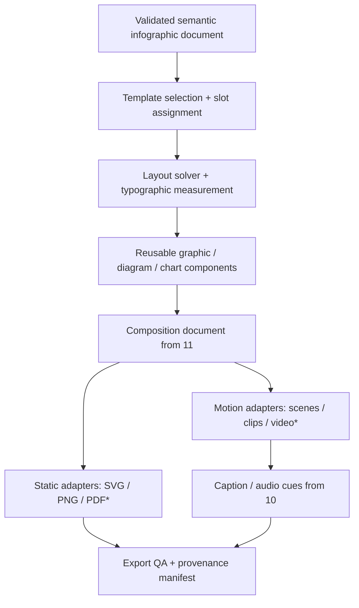

# 12 — Infographics, Carousels & Data-Driven Motion

**Status:** proposed implementation contracts, not implemented APIs. **Scope:** reusable, code-first infographic layouts, data visualizations, information blocks, and templates that produce editable static graphics, multipage carousels, and timed visual explanations from **one semantic source**. **Non-goal:** a Canva clone, drag-and-drop poster editor, charting framework rewrite, social scheduler, or automatic fact-checker.

**Read with:** [07 — Media Foundation](07-media-foundation.md) for registry conventions and graphic primitives; [08 — Motion Graphics](08-motion-graphics.md) for animation semantics; [09 — Explainer Components](09-explainer-components.md) for technical illustrations and storytelling; [10 — Character & Audio](10-character-audio.md) for narrated sequences; [11 — Rendering & Quality](11-rendering-quality.md) for the **canonical composition wire format**, capabilities, export, and QA. This file proposes **new infographic registry items** to add to the authoritative inventory in 07 when adopted; it does not fork the existing scene schema or reimplement those components.

**Reinspection note (2026-10-17):** the status line above ("proposed implementation contracts, not implemented APIs") is now stale about *what exists*. The infographic engine is implemented under `registry/infographic/`: semantic source types and validation, `editorial-grid` and `bento-grid` layout engines, information blocks, chart visualizers, annotations, art-direction profiles and parameterised templates, resolved to DOM/SVG (see the `infographic-system`, `infographic-view` and `infographic-templates` specs). Proposals below that were never built — for example `illustration-scene` and `venn-diagram` — remain proposals. Expanded QA and visual acceptance are **deferred, not passed**; **no exit gate is advanced or marked passed by this note**.

## 1. System boundaries: information first, layout second, motion third



`*` Optional exporter/capability; no automatic dependency. **Semantic source ≠ scene JSON:** the infographic document captures the meaning and evidence; the existing `Composition` from 11 captures resolved geometry, assets, identities, timeline, and rendering. All renderer implementations consume the same resolved composition contract, not React DOM snapshots masquerading as portable scene data.

| Layer | Owns | Does not own |
|---|---|---|
| Semantic content | Facts, ordering, relationships, units, labels, evidence, intended emphasis | Pixel positions, animation keyframes |
| Layout / template | Slot mapping, constraints, pagination, label placement, focal hierarchy | Arbitrary content rewriting or data manipulation |
| Primitives / components | Drawn marks, connectors, labels, charts, icons, panels | Publication scheduling, network fetching |
| Motion mapping | Reveal order, semantic state changes, handoffs, frame cues | Narration generation, unstated causal claims |
| Adapter / consumer | Rendering, encoding, asset rights, publishing, analytics | Quietly dropping unsupported content |

**Do not infer that a static poster can be animated by adding entrances.** Motion needs an explicit sequence of claims, focus states, and visual actions; static and motion variants reuse semantic entities while using separately planned composition.

## 2. Definitive infographic component extension

Names below are **proposed registry items**; lower-case kebab-case follows 07. P0/P1/P2 refer to shipping sequence, not compulsory dependencies. Compose existing `editable-text`, `layer-stack`, `media-frame`, `diagram-stage`, `data-flow`, `chart-reveal`, `callout-focus`, and motion tracks; do not clone them.

### A. Layout engines and information blocks

| Item | Contract; important failure behavior | Priority |
|---|---|---|
| `infographic-canvas` | Artboard wrapper with output recipe, safe/bleed regions, section flow, export metadata; delegates geometry to `artboard`. | P0 |
| `editorial-grid` | Asymmetric columns/rows, baseline rhythm, content order, gutters, pinned focal region; reject impossible constraints. | P0 |
| `bento-grid` | Tiles declare importance, min/max span, aspect preference, content minimums; deterministic packing; no cropped essential copy. | P0 |
| `section-stack` | Ordered blocks, dividers, section rhythm, optional page breaks; page boundaries never orphan a heading. | P0 |
| `split-composition` | Aligned A/B or text/visual regions, independent copy bounds, shared reference alignment. | P0 |
| `radial-layout` | Center/orbit/arc slots, label collision avoidance; fall back to linear layout when circumference is insufficient. | P1 |
| `path-layout` | Semantic milestones attached to a custom curve; tangent-aware placement and bounded label offsets. | P1 |
| `isometric-stage` | Deterministic projection + layer depth and anchor ports; not a required 3D engine. | P2 |
| `hero-statistic` | Typed value, units, date/denominator, evidence, locale-aware formatting; no decorative rounding that changes meaning. | P0 |
| `metric-card` | Metric, change, reference baseline, optional sparkline; distinguish absolute vs percentage-point changes. | P0 |
| `insight-callout` | Key claim, evidence reference, emphasis level, target anchor; never float unlabeled over a data series. | P0 |
| `numbered-step` | Ordered step title, concise description, state, connector anchor; consistent numbering through reflow. | P0 |
| `comparison-column` | Comparable dimensions, standardized units, synchronized row alignment, explicit unknowns. | P0 |
| `annotation` | Target ID, label, leader/bracket/arrow, preferred side, avoid zones, priority; fail if target disappears. | P0 |
| `icon-feature` | Accessible icon/asset + name + explanation; icon is not sole carrier of meaning. | P1 |
| `quote-block` | Exact quoted text + source attribution + attribution placement; escaping and overflow behavior. | P1 |

### B. Information structure visualizers

**Shared semantic graph:** stable node/edge IDs, ports, groups, hierarchy, importance, label constraints, data provenance; the existing `diagram-stage` renders relationships. The items below supply **structure-specific layout and interaction contracts**, not independent connector engines.

| Item | Semantic input / layout responsibilities | Priority |
|---|---|---|
| `process-flow` | Ordered/conditional stages, ports and branches, direction; distinguish optional, parallel and repeated actions. | P0 |
| `timeline-layout` | Dated or relative milestones, interval vs instant, irregular spacing policy; reuse `process-timeline` for animated behavior. | P0 |
| `hierarchy-layout` | Rooted trees, grouping, depth, balanced labels; preserve parent/child relationships under reflow. | P0 |
| `matrix-diagram` | Labeled axes or categories, cells, ordered quadrants; never swap axis meaning when adapting aspect. | P1 |
| `cycle-diagram` | Directed cycles with explicit loop point; don't use for noncyclic sequences. | P1 |
| `funnel-diagram` | Ordered stages with counts and denominators; widths proportional **only** if a quantitative scale is declared. | P1 |
| `pyramid-diagram` | Ordered levels; area/width must not falsely imply magnitude if categories are ordinal. | P1 |
| `venn-diagram` | Sets/intersections; validate whether illustration is qualitative or area-proportional; use UpSet-style fallback for many sets. | P1 |
| `sankey-diagram` | Weighted directed links, node balance/units, link-width scaling and conservation warnings. | P1 |
| `concept-map` | Labeled relation types and semantic groups; uses shared graph layout, not generic unlabeled arrows. | P1 |
| `exploded-diagram` | Layered parts, original assembly references, offsets, anchors and order; optional isometric projection. | P2 |
| `anatomy-diagram` | Approved visual asset + anchored labels/cutaways, focus masks, readable leaders. | P2 |
| `geographic-diagram` | Supplied projection/geometry, legend, region IDs, scale and attribution; geo datasets remain external. | P2 |

### C. Charts, illustration and infographic motion

A **shared chart grammar** should own data fields, transforms, scales, axes, marks, encoding channels, legends, units, uncertainty and annotations. Chart variants are recipes, **not** separate chart engines. Initial recipes: `bar`, `line`, `area`, `donut`, `scatter`, `heatmap`; later `treemap`, `waffle`, `slope`, `dumbbell`, `waterfall`, `small-multiples`, `sankey`, `bar-race`.

| Item | Reusable behavior | Priority |
|---|---|---|
| `chart-stage` | Typed series, validated scale/mark encodings, labels, axes and source footnotes; separate chart geometry from art direction. | P0 |
| `connector-path` | Port-attached line/arrow/curve, semantic direction, obstacle avoidance, motion-path reuse. | P0 |
| `diagram-build` | Ordered groups with persistent node/edge identity, focus targets and optional narration markers. | P0 |
| `data-reveal` | Reveal categories/series/marks by named semantic ID; leave axes and legend interpretable. | P0 |
| `focus-transition` | Coordinated framing/contrast/emphasis, explicit anchor and handoff; uses 08 motion primitives. | P0 |
| `chart-transition` | Interpolate stable categories/series and common scales; entering/exiting data has explicit policy. | P1 |
| `metric-counter` | Format-aware interpolation with controlled rounding; end result exactly equals authoritative value. | P1 |
| `annotation-reveal` | Show evidence/callouts when their target is visible; avoid overlaps with moving data labels. | P1 |
| `layout-morph` | Animate correspondence between **compatible resolved** layouts; unmatched items enter/exit deliberately. | P1 |
| `illustration-scene` | Reusable, anchored vector parts and semantic groups; stable IDs, referenced assets and styles. | P1 |
| `device-mockup` | Approved browser/phone/laptop frame and editable screen slot, perspective optional. | P1 |
| `spotlight-overlay` / `magnifier` | Focus mask or magnification with declared source region, zoom quality and caption avoidance. | P1 |
| `cutaway-view` | Masked cross section of supplied parts, linked section geometry and annotation anchors. | P2 |

**Reuse existing items:** `chart-reveal` from 07/09 orchestrates staged chart events; `chart-stage` owns data→marks layout. `callout-focus` orchestrates attention; `annotation` owns anchor/layout. `data-flow` animates packets; `connector-path` draws their attached routes. This is a division of responsibility, **not duplicate functionality**.

## 3. Template catalog: parameterized visual storytelling

A template declares **semantic slots, required/optional data, compatible visualizers, layout strategies, animation plan, and failure modes**. It must not embed fixed marketing copy, brand imagery, or a frozen grid. Variants are composition policies, not separate codebases.

| Family | Required slots / composition behavior | Launch |
|---|---|---|
| `editorial-overview` | Claim, hero visual, 2–6 supporting sections; asymmetric flow + evidence notes. | P0 |
| `bento-summary` | One primary insight, grouped secondary metrics/illustrations; salience-weighted tile packing. | P0 |
| `process-journey` | Ordered steps + optional branches; linear, vertical or path variants; sequential reveal. | P0 |
| `data-story` | Question, source data, chart, annotation, takeaway; chart/claim alignment. | P0 |
| `educational-carousel` | Cover → concept → evidence/example → recap; coherent slide handoffs. | P0 |
| `big-number-story` | One metric + baseline + denominator + evidence; no misleading isolated figure. | P1 |
| `timeline-story` | Time or milestones + scope; optional period bands, not equal spacing by default. | P1 |
| `comparison` | Cases + shared comparison criteria and units; aligned vs differential emphasis. | P1 |
| `framework-matrix` | Named axes + quadrant/cell rules; axis interpretation visible. | P1 |
| `layered-architecture` | Components + dependencies + grouping; stack or projected layers. | P1 |
| `circular-system` | True feedback loop, directions, entry/exit; radial labels. | P1 |
| `visual-cheat-sheet` | Dense categorized facts, strong scanning hierarchy, pagination when necessary. | P1 |
| `anatomy-explainer` | Main subject/asset, labeled parts, focus/zoom sequence. | P2 |
| `concept-map-story` | Central concept, typed relationships, progressive subgraph focus. | P2 |
| `roadmap` | Phases, milestones, dependencies, status; schedule claims with source dates. | P2 |

**P0 family coverage:** a five-template baseline is intentionally sufficient to test most layout primitives. New templates only earn a registry entry when a recurring **semantic composition** cannot be expressed cleanly by parameterizing an existing family.

### Template selection, not aesthetic guessing

1. Validate the content shape and primary question; examples: *what changed?* → `data-story`; *how does it work?* → `process-journey`; *how do options differ?* → `comparison`.
2. Confirm required slots, source evidence and number of entities; reject or request a shorter/split structure if infeasible.
3. Generate 2–3 layout candidates with the same facts and constraints; score legibility, whitespace, focal hierarchy, relationship fidelity and overflow.
4. Choose the highest feasible candidate; expose scores and constraint violations. **Never silently delete, fabricate, or paraphrase evidence to make a layout fit.**
5. Resolve profile-specific compositions (e.g., carousel vs poster) and then optionally generate a motion plan.

## 4. Semantic source and authoring API

This is an **authoring contract**, not a competing `Composition` wire format. Each content `kind` has a versioned discriminated schema; avoid `data: unknown` and runtime-executed callbacks. The example types show the initial P0 shape. Diagram/chart payloads use their own registered typed schemas, not opaque unchecked objects.

```ts
// Illustrative P0 authoring interface; validate with Zod/JSON Schema.
type Evidence = {
  id: string; label: string; sourceUri?: string;
  retrievedAt?: string; licenseNote?: string;
};
type BaseSection = {
  id: string; heading?: string;
  importance?: 'hero' | 'supporting' | 'detail';
  evidenceRefs?: string[]; // references Evidence.id
  summary: string;         // plain-language accessible statement
};
type Section =
  | (BaseSection & { kind: 'statistic'; value: number; unit: string;
      measureLabel: string; denominator?: number; period?: string })
  | (BaseSection & { kind: 'process'; steps: Array<{
      id: string; title: string; description?: string; nextIds?: string[] }> })
  | (BaseSection & { kind: 'comparison'; criteria: string[];
      cases: Array<{ id: string; label: string;
        values: Record<string, string | number | null> }> })
  | (BaseSection & { kind: 'chart'; chartRef: string })
  | (BaseSection & { kind: 'diagram'; diagramRef: string });
interface InfographicSource {
  kind: 'infographic-source'; version: 1;
  id: string; title: string; thesis?: string;
  language: string; sections: Section[];
  evidence: Evidence[];
  charts?: Record<string, string>;   // keys to validated chart registry entries
  diagrams?: Record<string, string>; // keys to validated diagram registry entries
  assetRefs?: string[];              // resolves via 11 asset manifest
}
```

**Authoring vs export:** source entities map to stable `semanticId`s in the `Composition` from 11; scene/layout IDs are deterministic from source ID + chosen variant + role (with collision handling). Section order is stable unless an **explicit** narrative-order field overrides it. SVG/PNG/video are derived outputs; the source, composition JSON, licensed assets and manifest remain the editable deliverables.

```ts
// Illustrative builder API; not a claim of an existing package.
const design = infographic({
  source: ragOverview,                    // validated InfographicSource
  template: 'process-journey',
  artDirection: 'minimal-technical',
  output: { preset: 'youtube-landscape', mode: 'motion' },
  animation: { strategy: 'progressive', cueRefs: ['search', 'retrieve'] },
  layoutPolicy: { overflow: 'paginate-or-reject' },
});
// design resolves to Composition (11) + diagnostics + provenance.
```

**Data integrity rules:** use exact original values for analytics, math and research; presentation rounding must be labeled and reproducible. `null` means missing, not zero. A statement inferred from multiple sources is distinguished from directly reported data. Every referenced claim should retain a provenance ID even if its citation is rendered in an endnote or separate carousel panel.

## 5. Responsive composition and output profiles

Aspect ratio is **not** a scale operation. Resolve constraints separately for each target; export then freezes layout into the fixed coordinate space specified by 11. Profiles are **editable presets**, not claims about universal platform behavior.

| Profile | Typical canvas | Required layout check |
|---|---|---|
| `youtube-landscape` | 1920×1080, 16:9 | Captions, moving focus, lower-third collisions |
| `short-portrait` | 1080×1920, 9:16 | Reflow hierarchy; reserve configurable UI/caption regions |
| `social-square` | 1080×1080, 1:1 | Compact copy, centered visual priority |
| `social-portrait` | 1080×1350, 4:5 | Editorial carousel reading order and edge zones |
| `pinterest-vertical` | 1000×1500, 2:3 | Vertical section rhythm and mobile-scale labels |
| `article-inline` | Consumer-defined | Responsive reflow and noncropped citations |

**Layout resolution:** measure text with pinned fonts/locale → compute content minimum sizes → select layout policy → place visual anchors → route connectors and annotation leaders → detect collisions → repair within declared bounds → reject with actionable diagnostics if unsatisfiable. Budget paragraphs/labels, not arbitrary minimum font sizes. **No shrink-to-fit loop below configured legibility floor.** Content may paginate, split scenes or use explicitly authored short labels; never silently truncate crucial facts.

**Text + cultural layout:** fixture Japanese/English mixed text, CJK line breaking, nonbreaking units, large digits, glyph fallback, bidi, long URLs and captions. Evidence/source labels cannot be dropped solely because the viewport is small. Multi-page exports maintain repeated headers/footers when configured without wasting half the panel on chrome.

## 6. Art direction profiles as tokenized rules

Styles are **visual recipes**, independent of information templates. Each declares type scale, typography roles, measure/leading, palette/contrast, spacing rhythm, strokes and borders, surface treatments, icon/illustration rules, chart palette, connector style, and compatible `motionProfileRef` from 08. All user-overridable; none implies a proprietary asset bundle.

| Profile | Distinctive, implementable defaults | Avoid |
|---|---|---|
| `editorial` | Strong display type, asymmetric columns, large negative space, fine editorial rules | Decorative card grids everywhere |
| `minimal-technical` | Grid precision, semantic connector colors, subdued surfaces, monospace where appropriate | Microtype, unexplained arrows |
| `cinematic` | Depth layers, restrained gradients, large focal elements, purposeful camera reframing | Glow, blur and motion on every element |
| `scientific` | Figure-first, evidence labels, uncertainty notation, annotation precision | Distorting axes for drama |
| `illustrated` | Consistent vector language, symbolic objects, friendly grouping, simple motion | Mixed unrelated icon styles |
| `sketch` | Controlled rough strokes, annotation marks, organic paths, restrained imperfection | Sacrificing readable geometry |

**Compositional rhythm:** one clear primary question/claim per panel; secondary detail supports it; alternate dense and quiet panels; source notes are subordinate but legible; charts must never compete with a dominant decoration. Use salience through size, position and contrast before adding effects. Template variation should change actual relationships/structure, not just colors or drop shadows.

## 7. Static-to-motion transformation rules

Motion derives from *semantic events*, not arbitrary stagger on every child. Create a **motion plan** with events `establish`, `reveal`, `compare`, `trace`, `focus`, `transform`, `annotate`, `hold`, `recap`. Each event has source IDs, target IDs, cue/frame range, and an objective. The plan compiles into 08 motion tracks / 11 scene clips; voice/audio cues use 10.

| Structure | Static view | Motion strategy | Correctness constraint |
|---|---|---|---|
| Process | Connected steps | Build nodes in dependency order; trace active path | Branches are not presented as sequential if concurrent |
| Timeline | Dated milestones | Move focal window; reveal by time | Uneven intervals retain declared temporal scale |
| Comparison | Aligned A/B | Reveal matching rows, then highlight differences | Shared scale/units remain consistent |
| Metric | Emphasized number | Animate value + reveal baseline/source | Landing value exact; don't imply live measurement |
| Chart | Axes + marks | Establish axes first, reveal series, annotate change | Scale domain fixed unless transition declares recalibration |
| Hierarchy | Tree / grouped modules | Progressive depth traversal + camera target | Parent/child identity preserved |
| Flow | Nodes + weighted links | Trace directional routes; optionally animate tokens | Speed/quantity do not falsely encode throughput |
| Bento | Mixed visual summary | Sequential focus/handoff between tiles | Tile reading order and claims preserved |
| Anatomy | Labeled asset | Mask/cutaway/zoom into named part | Callouts track real part IDs |
| Carousel | Sequence of related panels | Shared-element handoffs and planned pacing | Cross-panel objects retain `semanticId` |

**State correspondence:** `layout-morph` requires an explicit `{fromSemanticId: toSemanticId}` mapping. Unmatched elements enter/exit; categories cannot change labels or ordering without a declared transformation. A layout morph that misrepresents the relationship fails validation, even if visually smooth. **Determinism:** use 11's integer-frame timeline, rational FPS, pinned resources and seeded procedural effects. Random-access seeks must match linear playback.

**Narrative planning:** one proposition per shot; specify `claim`, `visualObjective`, `focusTarget`, `narrationCue`, `holdUntil`, `exitHandoff`. A 45-second video may need fewer distinct facts than a reference infographic. Don't force an entire dense poster into 45 seconds or require motion for content that is clearer static.

## 8. Data integrity, citation and visual ethics

| Risk | Required contract |
|---|---|
| Misleading axes | Numeric baseline/domain and scale type explicit; bar lengths normally zero-based; deviations require visible disclosure and justification. |
| Distorted geometry | Encode magnitude using perceptually meaningful area/length rules; circles encode by **area**, not radius, when area represents quantity. |
| Mixed units | Normalize or separate scales visibly; never infer percentage from an unlabeled fraction. |
| Missing data | Distinguish missing, unavailable, zero and suppressed; avoid interpolating across absent data without a labeled policy. |
| Uncertainty | Preserve ranges, confidence intervals, estimates and sample sizes where relevant. |
| Animated ranking | Stable IDs, deterministic ties, fixed temporal sampling; motion cannot invent intermediate observations. |
| Sankey flow | Check unit consistency and conservation; annotate losses/creation where intentional. |
| Geographic comparisons | Projection, normalization, legend, source and geographic scope explicit. |
| Attribution | Preserve source IDs, creator/asset rights, citations and retrieval date in output manifest; show source text in the artifact when publication requires it. |
| Accessibility | Meaningful summary, captions for motion, contrast, keyboard-authorable alternatives and reduced-motion representation. |

**Quality is not engagement prediction.** Small-preview legibility and polished design are measurable; click-through rate, dwell time and shares require external experiments. `thumbnail-variants` remains the proper A/B mechanism under 09.

## 9. Integration strategy: buy geometry, build composition

| Task | Preferred external utility | Own in Kumiki |
|---|---|---|
| Numerical scales/shapes/hierarchies | D3; D3 Sankey | Truthful data encodings, labels and stable IDs |
| Dense prebuilt charts | Optional ECharts / Observable Plot / Vega import | One canonical semantic chart document, not multiple incompatible schemas |
| Technical graph layout | Optional ELK.js (EPL-2.0 route) | Ports, semantic graph, narration states, cached resolved layout |
| Sketch-style illustrations | Rough.js / Paper.js | Art-direction profile and editable vector geometry |
| GPU charts/effects | PixiJS for exceptional density | Static/SVG fidelity fallback and per-mark semantics |
| 3D/2.5D infographics | Three.js adapter, orthographic camera, instanced geometry | Data→geometry mapping, faithful labels, explicit scale units |
| Exports | resvg/Sharp for images; renderer adapter for video | Unified source document, frame sampling and QA |

All engines are **optional**. Libraries are selected, license-reviewed, and version-pinned under [13](13-content-creation-integrations.md); no new infographic-specific scene schema. Three-dimensional charts must not obscure comparisons or misrepresent magnitude through perspective. 3D geometry is optional presentation, not a substitute for legible 2D quantitative comparison.

## 10. Acceptance fixtures, priorities and stop conditions

### P0 build sequence (complete vertical slices)

| Slice | Ship | Passing evidence |
|---|---|---|
| I0 | `infographic-canvas`, `editorial-grid`, `bento-grid`, `section-stack`, `split-composition` | 16:9 + 2:3 static artboards; deterministic content fit and overflow diagnostics. |
| I1 | `hero-statistic`, `metric-card`, `insight-callout`, `numbered-step`, `annotation`, `comparison-column` | Source-linked numbers, multilingual typography, responsive reflow, clipped-label rejection. |
| I2 | `process-flow`, `timeline-layout`, `hierarchy-layout`, `connector-path` | 12-node fixture with branches; attached connectors and stable IDs across portrait reflow. |
| I3 | `chart-stage`, `data-reveal`, `diagram-build`, `focus-transition` | Bar/line/scatter fixtures with truthful axes, reproducible reveals and explicit missing-data behavior. |
| I4 | Five P0 templates + output profiles | Same content generates editorial still, 2:3 poster, 5-panel carousel, and animated scene sequence. |

### Gold-reference production: “How RAG Works”

**Single source:** question → embed/search → retrieve chunks → construct context → generate grounded answer; supply evidence references for each explanatory assertion. **Four deliverables:** 1920×1080 video-ready infographic, 1000×1500 vertical poster, five-panel portrait carousel, and ~45-second narrated motion composition. Durations are illustrative and adjusted to speech cues; never add filler to hit an arbitrary timestamp.

**Required QA:**

1. Source→layout→`Composition` round-trip; exact values, terms, sources and IDs unchanged across four outputs.
2. Random-access render at first/last/cue/key/interpolation frames reproduces the same state as sequential rendering; no silent renderer fallback.
3. 16:9, 2:3, 4:5 and 9:16 variants **reflow**, not scale/crop instructional content; underconstrained content receives actionable diagnostics.
4. Japanese/English labels, unusual lengths, missing-value charts, intentional overlap and malformed inputs have fixtures; deliberate failures report layer IDs and target dimensions.
5. Transition handoffs retain semantic identities; nodes/ports/connectors remain attached; data encodings and reference notes remain accurate.
6. Verify at full export size and mobile-size previews; inspect chart annotations, evidence footnotes, legend, caption safe areas and paragraph density.
7. Clean registry install into a separate consumer has no video-renderer or ML dependency; save/reload retains source editability, manifest and rights metadata.

**Definition of done for each item:** typed props + runtime schema, versioned semantic payload, deterministic layout and static fallback, one real composed example, Storybook/preview, broken fixtures, accessibility summary, adapter capability notes, golden still/frame tests and an independently installable registry entry. See the release gates in [11](11-rendering-quality.md).

**Stop conditions:** Do not add twenty poster templates before five P0 templates meet the quality bar. Do not build map editors, full vector editors, advanced 3D, collaboration, AI image creation, or publishing integrations into Kumiki core. Add a component only when it represents reusable **behavior** that existing primitives and templates cannot express cleanly.
