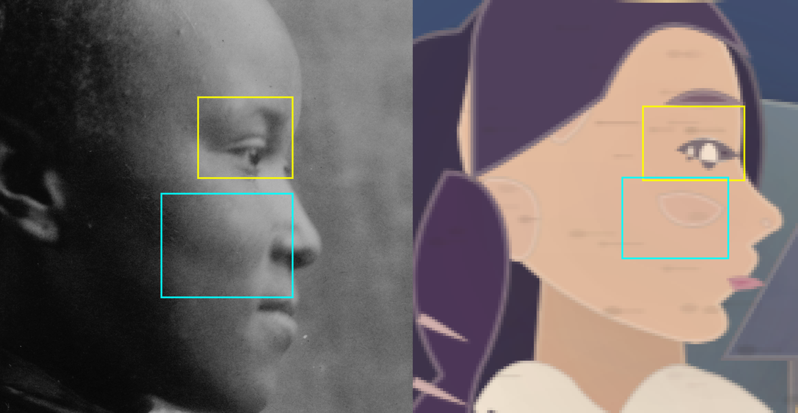

# ArtCraft PAPER-R3 — Royal character proportion and face reconstruction

**Working branch:** `art/paper-royal-anatomy-r3-20261115`  
**Status:** structural, source-led prototype; artistic approval pending independent source/render portrait gate.

## Why R2 failed

The actual R2 native FilmStage 16:9 render at act 3, frame 610, showed a pronounced vertical neck cylinder. The prince's visible neck extended from roughly the underside of the jaw to the lapel for almost a whole head-height; the princess's chin floated above the scalloped collar. Both had oversized cheek "stickers" and simplified childlike skull-to-torso scale. Source file: `src/video/paper-royal-story.ts`. No CSS filter or texture changes will solve these contour problems.

## Reference-led anatomy

These **rights-cleared geometric references** are for observing facial anatomy, not for copying a recognizable person's appearance.

1. [Public-domain 1900 right-profile female photograph, Library of Congress / Commons](https://commons.wikimedia.org/wiki/File:Young_woman,_facing_right,_head-and-shoulders_profile_portrait_LCCN2004676318.jpg), photographer attributed in Commons to Frances Benjamin Johnston collection. Visual observations: forehead eases into orbital recession, nose tip forms a rounded projection, upper lip sits below the alar base, chin returns beneath the cheek and joins a sloping neck. A small neck-to-chin gap is appropriate; the R2 cylindrical vertical exposed strip is not. Public domain status confirmed on Commons; the photograph itself is **not committed**.
2. [Library of Congress, c. 1899–1900 head-and-shoulders male portrait](https://www.loc.gov/pictures/item/99472193/) — side/three-quarter profile provides temple, brow, nose-lip and coat-collar connection. Photographic study, not traced as an actor or used to depict the model. Reuse rights must be confirmed before redistributing images; no image bytes copied to repo.
3. [Lotte Reiniger's account of cut-paper puppet construction (1936)](https://www.bfi.org.uk/sight-and-sound/features/scissors-make-films-lotte-reiniger-creating-her-magical-animations/) — each limb is a separately hinged silhouette, and natural gesture rather than elastic stretching makes movement intelligible. Our geometry changes preserve named PAPER-D2 `parentId` head/joint relations.
4. [Lotte Reiniger silhouette figures and costume composition](https://animationresources.org/filmography-reinigers-prince-achmed-the-first-animated-feature/) — source for solid-profile readability and intricate paper ornament, not character likeness.

**Historical rights/measurement limitation:** this initial pass used web previews without local source bytes. Two later candidate TIFFs were retrieved and hashed as documented in [the source notes](paper-puppet-contact-source-notes.md). Exact 18-landmark source→candidate photo comparison and tonal/portrait-fidelity scores **cannot truthfully be claimed**. Do **not** declare this a passed ArtCraft v7 portrait gate or world-class portrait yet.

## Structural reconstruction

| Part | R2 visible issue | R3 construction | Acceptance proxy |
| --- | --- | --- | --- |
| Adult cranial scale | Skull/hair/crown take too much vertical space | One `pen.sub()` mapping for each actor head (scale 0.84 around local cranial root y=−185) | Head/neck/gown or coat remain in a single figure silhouette |
| Neck and collar | Neck appears 0.8–1.0 head-height in visible frame | Head and facial sheets translated down +20 princess / +23 prince, neck contours shortened and tucked behind shoulder clothing | Exposed vertical gap smaller than half the head; no open seam across frame motion |
| Profile forehead/nose | Triangular noses and pointy sticker faces | Sculpt continuous forehead → nasal bridge → softened nasal tip → philtrum → lip → tapered chin, all within same closed skin sheet | Anatomical profile reads at native shot scale |
| Cheek | High-chroma unshaped white patch | Narrow low-contrast orbital and malar paper cuts tracing the jaw surface; remove giant floating cheek panel | No independent rectangular or round decal |
| Eyes/mouth/crown | Separate details drift when root moves | Every head, eyebrow/eyelid, mouth, hair and crown shares one sub-pen world mapping and `parentId` head hinge | Stable joint attachment under frame seeks, both aspects |

Character system is **original 2.5D papercut illustration**, not photorealistic portrait painting or frame-wise lip sync. A profile photo can inform proportions, but a human actor must remain an original non-identifying fairy-tale character.

## Review and release rule

1. Run focused PAPER1 / royal story Vitest and strict typecheck on the exact PR head.
2. Capture native FilmStage frame 610 and frame 370 in landscape and portrait; inspect both full compositions and 3× crops of the prince and princess at neck, eye, nose and mouth.
3. Check neutral and act-2/act-3 moving frames and the paper-curtain cut; reject detached head/neck pieces or clothing overlaps.
4. For a **portrait-quality** release, obtain a rights-cleared image, save its unmodified bytes and SHA, annotate 18 visible landmarks and tonal crops for source/candidate, run `portrait_fidelity_gate.py`, inspect overlay, and obtain independent review. Automated PAPER1/Storybook success is not a portrait-quality substitute.

**Remaining art priorities:** facial light-shape modeling, small hand anatomy, foot-contact/leg perspective, profile views from both directions, expression variation, and full-speed character gesture critique. 

## Actual R3 frame review and second face pass

First R3 artifacts are from [Paper Craft visual film proof #43690958235](https://github.com/YukiUmetsu/kumiki-ui/actions/runs/43690958235). The native act-three 960×540 frame shows substantially shortened exposed neck segments, no floating head, and consistently reattached crowns/eyes. **This is a genuine structural improvement, not a final facial-art approval.**

At 4× face crops, however, the princess's eye still reads like a generic white wedge and her lipstick projects beyond the nasal–chin contour. The prince's iris and eyebrow also appear like a mechanical dot under a thick horizontal stripe; the nasal tip and lip remain too exaggerated, and the side profile lacks a real ear silhouette.

Second contour correction on the same PR head: add a separate tapered princess brow, tighten sclera and pupil, recede both lips inside the closed facial outline, smooth both nasal tips, place a prince ear helix behind the sideburn, and re-register every new component to the face hinge. These are original stylized papercut contours. All are structural topology changes, not artificial microtexture or whole-frame filters.

**R3b evidence pending:** inspect new exact-head 3× royal faces and a normal-speed act transition after focused tests; withhold any high-fidelity/source-matched claim until actual licensed source bytes, source/candidate hashes, 18 individual landmarks, and the independent ArtCraft v7 portrait gate can be supplied.

## R4 continuity/gesture pass — source-led costume anatomy (2026-11-15)

Study sources from this pass, **craftsmanship only**; do not reproduce these people's likenesses or copy third-party character outlines:

- [The Golden Touch paper puppet pair, Nathaniel Devarie](https://natedevarie.com/artwork/4323978-The%20Kings%20Conflict%2C%20Paper%20Puppet%20for%20the%20shadow%20puppet%20show%20The%20Golden%20Touch%20%20%20.html): the two royal figures have hand-to-hand contact, shaped sleeves, narrow waist silhouettes and human-scaled wrist/hand hierarchy; not generic wrist circles.
- [BFI archive: Lotte Reiniger's physical Cinderella puppets](https://www.bfi.org.uk/inside-the-archive/features/object-week-lotte-reiniger-cut-out-figures-backgrounds-cinderella): observed small separate mechanical paper cutouts and deliberate costume negative space.
- [BFI/Sight and Sound: Reiniger describing original paper-film construction](https://www.bfi.org.uk/sight-and-sound/features/scissors-make-films-lotte-reiniger-creating-her-magical-animations/): real stiff limb components connected at joints, with natural motion studied frame-by-frame; avoid transparent morphs.

### Critique → structural correction matrix

| Anatomical region | Defect in actual R3b frames | R4 edit | Review criterion |
| --- | --- | --- | --- |
| Hands | Four mitten-like skin wedges with unarticulated fingers | Opposed thumbs, integrated palm silhouette, individual curved fingertip inflections; new princess left hand under cuff | Both hands have continuous sleeve attachment and distinct digit silhouette at 3× |
| Shoulder/collar | Visible vertical neckline line and broad crescent resembling a bib | Recut folded lace collar with scalloped clavicle overlaps; custom cut filigree stock follows the collar, not a shader | Neck remains shorter than head; no floating cuff or unsupported collar tip |
| Torso | Prince jacket has overly narrow shoulder roots and no tailoring line; princess waist feels unstructured | Broader coat clavicle cut, attached seam strips and bodice-to-skirt folded waist/pleats | Silhouette remains readable at final stage size |
| Narrative gesture | The royals stand too far apart to convincingly raise the central lantern | Reduce only final landscape pair's base distance from 132 to 120 paper units, retaining existing synced animation | Each extended hand reaches the lantern region without two actors passing through each other |
| QA | Previous browser captures only recorded full-stage videos, too small for facial inspection | On the **same** Storybook page, add stage/princess/prince zoom mode that magnifies the real full-resolution stage by 3× with no alternate face renderer | Browser captures two full-size facial view crops per aspect; stage mode restores unchanged native render |

**Portrait hard stop is unchanged.** The linked public domain photography under [Library of Congress profile woman 1900](https://www.loc.gov/item/2004676295/) and [male profile photograph 1905](https://www.loc.gov/pictures/item/00651810/) provide candidate anatomical study, but we cannot claim a measured high-fidelity source/candidate reconstruction without locally available unchanged photographs, both hashes, independently annotated 18-landmark sets, tested tonal regions, and independent human review. Therefore this PR stays **experimental and unmerged** if this evidence cannot be produced. The R4 hand/costume improvements are separately testable and do not substitute for approved face details.

**Render review required on latest head:** FilmStage 130/370/610 landscape and portrait, plus new loupe PNGs for princess and prince at act 3. Inspect hand-lantern overlap at 0/120/239 absolute shot frames, panel opacity, face detail and portrait cropping; technical CI pass alone is not artistic sign-off.

## R5 preview-derived facial silhouette study — **unapproved prototype**

The latest 512px web-visible photographic previews suggest a specific proportional failure in the R3b face crops: the actress-like princess's lip and nose advance correctly, but her chin retreats almost to the neck line, whereas the female profile photo shows a more forward chin in front of the ear root. The prince has the same issue, with different reference-specific chin projection. Both eye apertures are oversized wedge cuts for a right-facing profile.

- Source female: [Library of Congress photograph of a woman facing right, circa 1900](https://www.loc.gov/item/99472203/), as surfaced in a 512×512 copy. Rights advisory: no known restrictions on publication; use only abstract anatomy, not person likeness. Estimated preview landmarks: ear root (236,246), eye center (316,230), nasal tip (354,258), mouth center (343,286), chin (330,319). **These are approximate eyeballed coordinates from a scaled online preview, not annotated evidence from original source bytes.**
- Source male: [Library of Congress Warren G. Harding side-profile photograph, 1920](https://www.loc.gov/item/2006691556/), mirrored conceptually to the fairy-tale prince's right-facing profile. Estimated preview landmarks: ear root (326,180), eye (181,174), nose tip (123,239), mouth (149,282), chin (180,335). These also are *rough visual estimates only* and require source inspection.
- Candidate R5: increase anatomical chin projection relative to the rear ear and nose tip, reduce the overly long horizontal sclera wedge, align the iris with the new aperture, and author small ear cartilage/nostril cuts *on existing cheek stock* to avoid more oversize sheet counts. This is a study of **shape proportions**, not a traced likeness.
- At the R5 preview pass, full-resolution source bytes and checksums were not available; the later retrieval and hashes are documented in [the source notes](paper-puppet-contact-source-notes.md). The **18-source-landmark immutable-photo ArtCraft v7 portrait gate is not satisfied**. This PR remains unmerged until actual image/hash, independent per-region source/candidate measures and independent artistic review are available. Zero acceptance is inferred from green TypeScript, layer-budget or browser tests.

R5 reference-to-geometry notes are recorded as a non-release preview atlas in [paper-royal-profile-preview-geometry.json](paper-royal-profile-preview-geometry.json); it must **never** be mislabeled as a validated portrait_fidelity_gate.json.

## Portrait deer framing correction — visual work remains open

The exact-head native frame 610 showed the deer's head cut off at the right edge and its body obscured by the foreground tree. The portrait placement now moves the deer inward without changing its cut paths or landscape position. A browser regression checks the rendered deer body, head and antler path bounds at the chapter buttons’ selected preview frames. A native portrait frame 610 was rendered and inspected: the head is within the stage, but the tree still crosses the antlers and the animal overlaps the prince/fox grouping. This is a partial framing correction, not an accepted composition or a completed motion review. Inspect all beats and stress frames, improve overlaps, and retain the portrait fidelity and independent review gates.
## R5 native-vs-Storybook image audit — unexpected film-curtain occlusion

Actual GitHub Actions browser PNGs from [run #43693882898](https://github.com/YukiUmetsu/kumiki-ui/actions/runs/43693882898) exposed a long-lived false positive: Storybook browser captures for the second and third chapters showed only pale solid paper even though native FilmStage frames 130/370/610 contained the correct actors. The Storybook controls sought directly to the new shot's **local frame 0**, during PAPER-D2's **intentional, fully opaque 12-frame opening paper curtain**. The browser tests verified SVG DOM layers and screenshotted the curtain, so they never proved that the visible scene was present. The 3× loupe screenshots inherited the curtain; screenshotting the transformed element rather than its fixed-size outer film viewport yielded off-target white margins.

**Fix the preview, not the production curtain:** clicking chapter 2 or 3 opens at local frame **18**, after the 12-frame curtain reveal; scrubbing and restart still allow seeking exact frame zero. Browser tests assert the exact local frame and no active `[data-km-paper-curtain]` before capturing the actual scene and the loupe's fixed viewport. This is an explicit visual acceptance requirement, not just DOM existence. Older Storybook screenshot proofs for chapters 2/3 are invalid as artwork evidence; native FilmStage proofs remain valid.

## Rejected foreground-fox experiment

A portrait-only trial moved the fox down 105 sheet units and placed its layers above the foreground bank to separate it from the prince's boots. A browser bounding-box assertion passed, but the first native portrait frame 610 hid the fox behind the bank; raising its stock above the bank made the fox look isolated and unsupported on a large empty field. Both candidates were discarded. This is an art-review failure despite the passing geometry assertion. The original overlap remains; investigate grounded staging, coherent foreground construction and motion in both aspects before another change. Neither candidate nor its assertion was retained.

## Portrait fox staging iteration

The second tested portrait placement brings the fox to the left foreground, near the existing bank, and keeps its opaque paper layers above that bank. The original paths and landscape placement remain unchanged. Native portrait frames 130, 370 and 610 were rendered and inspected: the fox no longer covers the prince's boots, and the body, head and tail remain within frame in those samples. The fox still overlaps the princess's skirt, while the deer overlaps the prince in the earlier scenes; this is a partial improvement, not a passed artistic or full-motion review. Browser checks cover frames 30, 130, 270, 370, 510, 610 and 710 and the fox body/boot rectangles, not every animal outline or frame. Source-based portrait evaluation and independent review remain open.

## Rejected deer-spacing trials

At portrait frame 130, scaling and lifting the deer hid most of its body behind the prince and tree; moving it farther right and placing the tree behind it exposed an animal that appeared unsupported above the ground. A separate trial shifted the prince inward in the first two acts: a 70-unit shift cleared a deer-body/coat bounding-box check, but at frame 370 the prince's face and hand crowded the lantern and rabbit. All three trials and their candidate assertions were discarded. Fixing the deer requires a coordinated scene layout and ground-plane study, not merely satisfying a rectangle test; the current deer remains partly obscured in early acts.

## Coordinated portrait staging trial

For portrait only, the first two acts shift the prince inward, slightly reduce the deer with uniform scaling, and place the right trunk behind the deer; landscape and the final-act prince placement are unchanged. Native portrait frames 30, 130, 270, 370, 510, 610 and 710 were inspected: the deer is more legible at the sampled midpoints and stays within the stage, but its body still overlaps the prince's cape at frame 270; the fox and princess skirt also touch. A browser regression checks deer-body and prince-coat rectangles at frames 30, 130, 270 and 370 only, and is not a full silhouette or motion guarantee. Frames 230 and 470 were rendered but not visually assessed because they fall in curtain transitions. Normal-speed motion, portrait fidelity and independent art review remain open.

## Landscape fox overlap correction

Independent inspection identified the fox crossing the prince's hand and lower body in landscape frames 370 and 610. The landscape composition now places the existing fox near the left foreground and paints its opaque sheets above the foreground bank. Native landscape frames 130, 370 and 610 were inspected: the fox stays readable and clear of the prince in these samples. The fox is farther from the prince, so the "fox guides" narrative connection still requires a normal-speed acting review; the layout change alone does not establish it. A browser check tests the fox body, head and tail against both prince hands and boots at those frames and checks horizontal bounds. It does not measure all frames or human artistic quality. Portrait fidelity and independent human review remain open.

## Historical ArtCraft v7 package availability audit

The available `artcraft-macos-v7.zip` identifies its main skill as v7 and adds `art-human-anatomy`, but it does **not** include the `portrait_fidelity_gate.py` or `portrait-reconstruction-gate.md` named in the portrait rebuild quality gate. Its anatomy comparator is a different, image-space ratio tool and cannot replace the required portrait/tonal gate. Its portable data status reports 22 measurements and no full registry.

The v7 anatomy source manifest also records a 39-character hash for `registry/anatomy/anatomy-react.tsx`. The pinned repository commit `51eff65f621174d963bebaba8bc08506f7812453` identifies its full git blob as `406d48a047ce379fc7492bd342e77dc65942a52b`. The unmodified package's registry sync failed on this mismatch. A temporary package copy with that one hash corrected successfully retrieved the pinned registry and photo plates; `anatomy_data.py --snapshot /tmp/artcraft-anatomy-51eff65f verify` passed all 17 manifest entries. This does not repair or install the original package, establish 18 independently observed source/render landmarks, assess five value planes, or approve the characters. Both original photo candidates are near profiles with occluded far-side landmarks; do not invent those observations. The PR's portrait gate remains open.

## Isolated eye and cheek study — unresolved

A direct source crop from the Library of Congress woman TIFF (`x=1650, y=1600, 650×650`, SHA-256 `ba15e56b9e3f17b51b232e1da6ba5279138a2927425d5ca7e488647496eb50e2`) was inspected beside a crop of the actual cd4727aa Storybook princess loupe (`x=185, y=395, 140×150`, crop SHA-256 `ef53892f92096fedc912845bd32f5bde275bb5d8ec57ff9d20d1f62c1d10419a`; parent screenshot SHA-256 `2b8e5c3a4e7d7ab0940b1dcedcc9f48ef969faee96dd9a33b6504bdcfbbf6e4a`, [run 43711664449](https://github.com/YukiUmetsu/kumiki-ui/actions/runs/43711664449)). Crop files are temporary inspection artifacts, not embedded source art. The original TIFF URL, source hash and rights are in [the source notes](paper-puppet-contact-source-notes.md).

The source near eye has an upper lid that covers the upper iris, a sloping lid crease and a broad, gradual socket shadow; its cheek transitions gradually into the nose and jaw. The rendered eye has a light wedge, tiny dark eye mark and short upper contour, while its cheek is an outlined closed patch rather than a continuous value plane. These are real visible differences in **construction**, not measured identity errors: the photo is a three-quarter view and the original puppet is a more profile-oriented stylization, so a pixel or landmark similarity score between these crops would be misleading. The far-side features are partly hidden; mark them unobservable rather than inventing coordinates.

Next: choose an appropriately matched, rights-cleared source/view and define a source-specific static eye/cheek construction and independently annotated landmarks before changing production paths. Compare the actual source and candidate crop at 1×/3× and run the required gates; maintain the current study as unapproved until then. The v7 anatomy comparator is supplementary; the later v9.1 gate availability is documented below.

An independent crop reviewer confirmed the observations and hashes but noted the rendered mark is too raster-limited to establish precise pupil occlusion. The view mismatch, source/render landmark and tonal measurements, required portrait gate, motion review and human approval remain open.

### Additional right-profile source candidate

The Library of Congress [right-profile portrait, item 99472180](https://www.loc.gov/pictures/item/99472180/) is a closer view-direction candidate than the previous three-quarter source. LOC lists no known restrictions on publication; the original album has restricted physical access. Its [digital TIFF](https://cdn.loc.gov/master/pnp/cph/3c20000/3c24000/3c24700/3c24782u.tif) was retrieved unchanged, SHA-256 `64d7d628a99b2482d0fce820733918b3b68e19e34d71598d794a04abaab98bd9`, 3297×4096. An inspected `x=1400, y=1200, 900×900` crop has SHA-256 `e331fd4fdab1cbda5ad192b2ebc99cbacae0bf85929144e3f6cdae6b0eb9ac64`. In this crop the brow-to-nose bridge recedes before the projecting nose; the cheek turns gradually into the jaw, and a dark eye is recessed under the brow. Fine eyelid boundaries are soft and the far eye is occluded. It may inform a profile understructure, but it is **not** a chosen identity target or sufficient evidence for 18 bilateral landmarks. No source-to-render pass is claimed; compare only independently observed features at matching pose and retain uncertainty.

### Profile comparison board (diagnostic, not a fidelity pass)

**Board legend:** left = LOC source photo at 1×; right = actual cd4727aa Storybook output crop at 6×, enlarged with nearest-neighbor sampling. Yellow = eye region; cyan = broad cheek region. The source cyan box includes part of the nose and upper lip, whereas the output box mainly encloses the cheek patch. The source crop truncates the lower chin. These are unregistered regions from different subjects and poses, for qualitative study only—not matched masks, landmarks, or a fidelity score.

The [source crop](assets/paper-royal-study/profile-source-crop.png) comes from LOC item 99472180, with no known restrictions on publication as noted above; its SHA-256 is `e331fd4fdab1cbda5ad192b2ebc99cbacae0bf85929144e3f6cdae6b0eb9ac64`. The [candidate crop](assets/paper-royal-study/princess-output-crop.png) is derived from the actual PR Storybook loupe at cd4727aa; its SHA-256 is `ef53892f92096fedc912845bd32f5bde275bb5d8ec57ff9d20d1f62c1d10419a`. The annotated board SHA-256 is `8195bd8acf19a11caad4080d47f1ab1f70d5f36eacd4600526fc8b336e035b80`. Source details, crop coordinates, parent screenshot hash and limitations appear above. The crop is a research reference, not a likeness target or redistributed library asset.

## ArtCraft v9.1 availability and gate scope

The installed ArtCraft skill now supplies `artcraft/scripts/portrait_fidelity_gate.py` and `art-human-anatomy/scripts/human_anatomy_fidelity_gate.py`. The full anatomy snapshot is present at pinned revision `51eff65f621174d963bebaba8bc08506f7812453`; `anatomy_data.py verify` passed all 17 manifest entries. The ArtCraft virtual environment has the portrait gate dependencies. A synthetic smoke check returned pass for identical inputs and fail for a different image; this establishes only that the script runs, not portrait quality.

The v9.1 portrait tool reports SSIM, edge and histogram metrics and optional landmark/ratio metrics. Its landmark inputs are optional, and it does not itself implement the project portrait gate's independently observed 18 landmarks and five matched value planes. The v9 human-anatomy gate separately requires registered, independently annotated source/render figures and semantic masks for visible anatomy. These tools do not make the existing unregistered photo-to-stylized-puppet comparison valid. A view/pose-matched source and actual-render annotations, required tonal evidence, gate results, normal-speed review and human artistic approval are still missing; the PR remains unapproved.

## Exact-head high-resolution review (a5251e15)

The existing Storybook loupe was captured at frame 610 in landscape, with Chromium device scale factor 3. These are actual rendered stages at 2880×1623, not reconstructed or upscaled character art: [princess](assets/paper-royal-study/princess-a525-3x.png), SHA-256 `9ecdc6c37fad52750af6db2c6ae914b36562012d1a4d5f6813ecc7ab3ea07b93`; [prince](assets/paper-royal-study/prince-a525-3x.png), SHA-256 `8bc4e6b0f671e8f859009e1e6ff7fbc04c65f375f82bb373e4899b04ad2fbc7b`. The Storybook loupe itself magnifies the live stage 3×; device scale preserves more of the browser's vector rasterization for inspection. The captures do not represent native film resolution or establish motion quality.

A separate visual reviewer examined both captures against the earlier female eye study. The princess's eye reads as a pale oval hanging below the upper contour; the prince's iris likewise protrudes below the light aperture. Both outlined cheek cuts read as separate patches, and straight stock marks cross facial features without following their form. The prince's neck remains stiff. In the photograph, the upper lid overlaps the iris and the socket and cheek transition gradually into the nose. This is a qualitative construction comparison: the photograph and illustrations differ in view and subject, so it is not a likeness or anatomy-gate measurement. The reviewer did **not** approve the faces. Construct and independently inspect a view-matched static source study before revising the production eye, socket and cheek; do not treat additional surface marks as a fix for their underlying contours. The 18 independently observed landmarks, five matched value planes, applicable executable gates, full-speed motion review and artistic acceptance remain open.

### Portrait loupe framing correction

The prince's portrait stage position is shifted left in chapters one and two, but the Storybook review loupe had omitted that shift. A browser test with transitions disabled measured the chapter-one head center at 32% of the viewport width away from center. The loupe now uses the same chapter-specific offset as the stage. Actual corrected Storybook viewport captures for [chapter one](assets/paper-royal-study/prince-loupe-chapter-1.png) and [chapter two](assets/paper-royal-study/prince-loupe-chapter-2.png) have SHA-256 `cd93cad83e6dec041a536327b35435108183dba71b26902239305377048f8d99` and `eada457b3df18340108970ef5ac871c7f024bd2f91de45eca9ea36920f42708f`; both show motion 0. A separate reviewer checked all three chapter captures and found the face visible and horizontally centered enough for review. This is a framing check only; it does not approve the anatomy, art or animation.

### Reduced-motion chapter navigation

The Storybook review previously forced the entire film to its final frame when reduced motion was enabled, making all three chapter buttons ineffective. The core correction was extracted and merged in PR #509. Reduced-motion mode now keeps chapter selection available, displays each selected chapter in the renderer's still end pose, disables the frame scrubber and playback, and removes the loupe transition. A Chromium regression verifies all three chapter selections and the disabled and non-animated controls. This is an accessibility and review-control fix; it does not approve the characters or motion.

## ANAT1 foundation guide (2026-11-16)

The branch now includes the current human-anatomy, animal-anatomy and materials foundations. To investigate the royal faces, `node scripts/anatomy/face-projection-study.mjs <output-directory>` constructs the actual ANAT1 canonical MediaPipe mask with `createFace({ calibrate: false })`, projects it with `renderMeshFrame` at yaw −75°, −45°, 0°, 45° and 75°, and draws named `faceFeatureLines` over its five discrete light bands. The output retains each feature name as an SVG attribute. [Chromium capture of the generated guide](assets/paper-royal-study/anat1-face-projections-guide.png) SHA-256 `c5539b981d2ca54333d1a9b83ba21d40ee0c5b7ceb8edfaaefa765386c35328d`; generated SVG SHA-256 `6afe93bf717b4cf5916db6d0938aa49a1e80db2a5b4643931ff62cc8e4d4f650`.

The projected guide makes the orbital recess, nasal bridge and the transition from lower lip to chin easier to inspect at the intended approximate side view. The princess's existing pale oval below the eye and detached outlined cheek do not describe those forms; revise the connected upper/lower lid and cheek construction against a view-matched source before touching the rig. The model's open face mask has **no ears or back of skull**, its five color bands are triangulated construction cues, and its feature lines are facing-filtered rather than depth-occlusion tested, so a far-side line may show through. The panels are not the photographed subject or an anatomical measurement of either character. The guide is not paper material, a portrait comparison, an independently annotated source, a production face or artistic approval. Five source-matched planes, 18 independent landmark pairs, the applicable gates and source/render visual review remain outstanding.

The updated MATL1 includes `paper-washi` and its `materialTexture` fibre study; it is a reference for paper formation, not a drop-in replacement for the existing colored opaque cut-stock. Its white-paper sample is explicitly a stand-in for washi. Do not map its absolute colour or real-world millimetres onto the current stage without defining physical sheet scale, inspecting overlaps and checking performance. The existing ANIM1 fox scaffold remains in [the fox study](paper-royal-fox-guidance-study.md).

### ANAT1-guided princess eye trial — rejected

A local, unmerged trial used the visible near-eye curve from the −75° ANAT1 guide to reshape the existing white aperture, dark iris and upper-lid stock while keeping their head attachment and sheet count. The existing photo and foundation projection were guides, not matched landmark evidence. [Before](assets/paper-royal-study/princess-anat1-eye-before-3x.png) and [trial](assets/paper-royal-study/princess-anat1-eye-trial-rejected-3x.png) are equal crops of the actual Storybook loupe at chapter three, motion 0 and browser device scale 3; their SHA-256 hashes are `99d99d7f55205c5a57c125dfe74a08c8adb0286b152d2c7e63eed95a7915cc96` and `9bcfea0103005e55b5bdbdc19deaab89b50110fd0f6a96f6615b8f3dd74d47e8`. The loupe is an enlarged inspection view, not native film output.

A separate reviewer compared the actual 1× face crops and full stage with the public-domain profile crop and ANAT1 guide. The trial's pupil reads as a block inside a bright graphic aperture; the photograph's profile eye is smaller and shadowed with its iris more occluded by the upper lid. The edit does not address the orbital socket or cheek, and at full-stage scale the difference was too small to assess confidently. The candidate was rejected and its production-path edits were reverted. Next, construct and review a source-aligned eye, socket and cheek together; a model-derived curve alone is not a matched source or an artistic pass.
