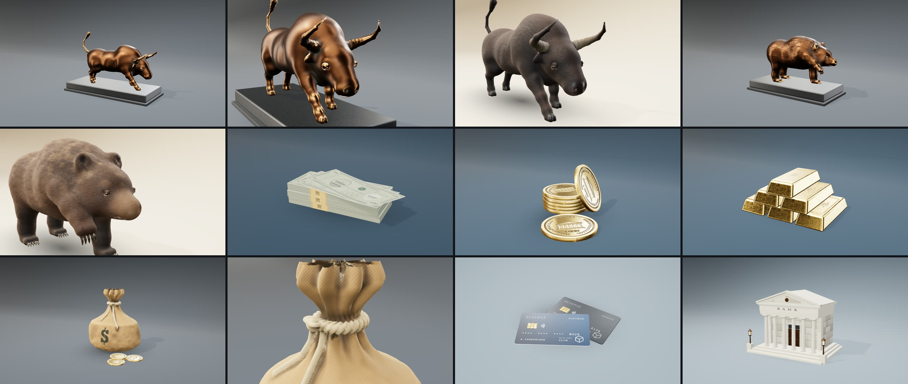

# 2026-10-19 — Finance hero 3D assets: verification

## Before
The previous assets were primitive assemblies (bull/bear from intersecting ellipsoids on a slab; cash as a
single box with a disc; bank as a box kiosk), framed at ~15% of the frame, on a floor with a visible horizon
and without an environment map, so metals reflected nothing.

## Rendered views actually inspected (agent, headless Chromium + WebGL)
Captured through `Domains/Finance Hero Assets` (URL params `kmHero, kmAz, kmEl, kmZoom, kmTarget, kmFinish`)
and through the legacy `Domains/Finance Objects` stage with `scripts/audit-finance-3d.mjs` (bull, bank, card;
four views each). Close-ups inspected: bull head (bronze and natural), bull eye, bear head (bronze and natural),
money-bag neck, bank entablature, banknote texture flat. Issues found and fixed during review:
cyclorama edge visible in wide FOV; buried eyes (now seated by ray-march); zebra horn blend; lattice-block
fur noise (now gradient noise); washed-out paper and cards (per-asset exposure); note layout collisions;
coin halves wound inward (reverse design visible); hidden dentils; protruding tympanum; buried rope cinch.

## Commands and results
| Command | Result |
|---|---|
| `npx tsc --noEmit -p .` | pass |
| `npx eslint registry/craft registry/domains src/domains …` | 0 errors (pre-existing `fps` deps warnings remain) |
| `npx vitest run --project unit` | 101 files, 1470 tests passed |
| `npm run registry:validate` | 84 items valid |
| `npm run registry:smoke` | 84 items, 996 files staged |
| `npm run registry:fixture -- --item=domain-finance-objects-3d` | 22 items, 75 files compiled (no usage template for this item) |

Also fixed: `scripts/audit-finance-3d.mjs` waited for a `hidden` ledger element to become visible and could
never run; it now waits for `attached`.

## Not done / limitations
- No human photographic comparison; no asset is marked `passed` in the review ledger.
- GPU frame time, draw calls and texture memory not measured.
- Bear body proportions and claw thickness need another pass; natural animals are stylized-realistic, not photoreal.
- Storybook interaction tests and visual-regression goldens were not added (user prioritized asset code).
