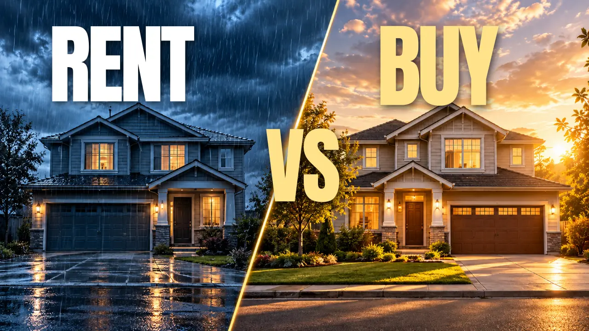

# House Math editorial thumbnail fidelity — 2026-10-23/24

## Visual review

These previews were exported from the **actual M0 documents** via
`scripts/export-house-math-thumbnails.ts`, rasterized with Inkscape at 1280×720,
then converted to small WebP files for repository review. They are **not** the
AI-generated reference screenshots with baked-in lettering. The headline/cue
content lives in text layers and the full-bleed photo is a separate replaceable
media layer. Individual objects within the scene remain raster pixels.

| House cost | HVAC expense | Rent vs buy |
|---|---|---|
|  |  |  |

Visual inspection performed on these rendered exports:

- All images fill a 16:9 frame. Buildings, condenser mechanisms and price/comparison
  cues are identifiable at full resolution.
- White/gold-or-orange type is legible over the selected negative-space regions;
  no text is clipped. The original overwide font, accidental two-line headline
  and HVAC/subject crowding were corrected through repeated real SVG exports.
- The same exports were resized and manually inspected at 320, 160 and 96px.
  The 96px result is compressed, but core words remain recognizable.
- This verifies **Inkscape rasterization**, not browser canvas export. The
  Playwright Chromium download was unavailable in this environment, so
  Storybook's browser-to-PNG path still requires human verification.
- The final text-free JPEG scene assets (visually reviewed at high quality),
  not the reference PNGs, are used by Storybook. The exported artboards can
  still be saved as PNG.
  The image origins and exact file hashes are documented in
  [`ASSETS.md`](../../src/media/thumbnail-examples/ASSETS.md).

## Reproduction

From the repository root:

```bash
./node_modules/.bin/esbuild scripts/export-house-math-thumbnails.ts \
  --bundle --platform=node --format=esm --loader:.jpg=dataurl --loader:.ttf=dataurl \
  --outfile=/tmp/kumiki-thumbnail-export.mjs
node /tmp/kumiki-thumbnail-export.mjs /tmp/kumiki-house-math-thumbnails
```

This produces three self-contained `*.svg` files and matching
`*.diagnostics.json` reports. Inkscape can rasterize them, provided Anton is
installed in the font resolver; non-browser SVG readers may ignore an embedded
`@font-face`, even though Storybook browsers load it directly.

```bash
inkscape /tmp/kumiki-house-math-thumbnails/house-cost-editorial.svg \
  --export-type=png --export-filename=/tmp/house-cost.png
```

## Recorded checks

| Check | Result |
|---|---|
| Three editorial SVG documents | **Pass**: each produced zero errors |
| Thumbnail-specific preflight | **Pass**: only an expected `thumbnail-text-metrics-estimated` warning per scene when no canvas was available |
| `npx vitest run tests/media-text-layout.test.ts tests/thumbnail-art-direction.test.ts tests/thumbnail-editorial-showcase.test.ts` | **Pass**: 23 tests across 3 files |
| `npm run build` | **Pass** |
| `npm run build-storybook` | **Pass**, Storybook 10.6.2 |
| `npm run registry:validate` | **Pass**, 152 items |
| Focused ESLint on all modified TypeScript/TSX files | **Pass**, no errors/warnings |
| `npx vitest run --project unit --silent` | **1,687 passed; 1 unrelated pre-existing failure** (`tests/tmp-causal-system-stage.test.ts`: `causal-overlap` on edge `l5`/node `emitted`) |
| `npm run typecheck` | **Blocked by pre-existing errors outside media thumbnails** in `registry/visual/causal-system-stage*`, `registry/visual/map-stage*` and `src/visual/causal-system-stage.stories.tsx` |
| `npm run lint` | **Blocked by pre-existing unused `label` in `registry/visual/causal-system-stage.ts`**; 11 warnings outside touched files |
| Storybook browser canvas PNG export | **Not performed**: Chromium unavailable; requires follow-up |

The code does not claim that these designs will achieve any particular CTR.
Visual effectiveness still requires actual impressions and thumbnail tests.
