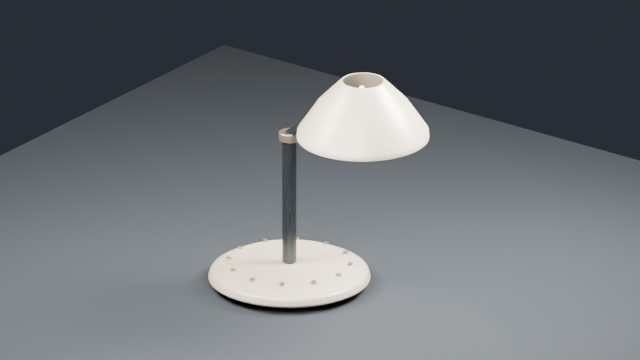
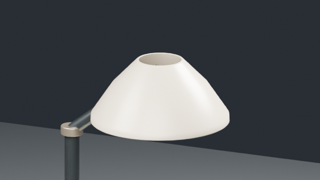

# Blender → Kumiki Revision Bridge: real-export check (2026-11-02)

## Source and capture

- Source: `kumiki-blender/examples/desk-lamp-assembly-v2.json` (original
  first-party declarative geometry; no licensed third-party models).
- Blender: **4.5.4 LTS**, headless `--background --factory-startup`,
  `KUMIKI_RENDER_PROFILE=smoke` (640 × 360, 8 samples).
- Exported revision: `/tmp/kumiki-blender-bridge-fixture-r01/` during QA,
  generated from the compiled AssetSpec using the standard Blender exporter.
  The GLB and unmodified manifest are checked into
  `src/craft/fixtures/blender-desk-lamp/` to make Storybook reproducible;
  `.blend` and raw producer QA views are regenerated from the source spec.
- `audit-revision --root /tmp/kumiki-blender-bridge-fixture-r01`: **PASS**.
  17 meshes, 17 semantically tagged nodes, 3 materials, no external GLB
  dependencies, a 505,400-byte embedded GLB. The producer audit also checked
  `.blend` and PNG signatures, sizes and manifest parity.
- Vitest imports that **real GLB**, finds all 12 `base-fasteners` and the
  `enameled-shade`, and builds renderer-native inspectable bounds. jsdom has
  no image decoder: the unit test substitutes a 1 × 1 `createImageBitmap`
  result to inspect structure, not material fidelity. Other tests exercise
  real Three.js glTF export/import, independent instances, animation,
  SectionReveal isolation/ghosting, streaming limits and external URI refusal.

## Render proof and visual review





Observed: intact table-lamp silhouette, separately formed base/arm/shade and
small base fasteners. The small smoke preview has relatively flat enamel,
light edge definition and no convincing visible bulb/interior. This is an
**interop fixture**, not a cinema-quality hero prop or visual acceptance.
No matched browser WebGL screenshot was captured in this environment; final
GLB material/lighting parity and design quality remain for human review.

## Reproduction

```bash
cd kumiki-blender
PYTHONPATH=src python3 -m kumiki_blender compile-asset \
  --spec examples/desk-lamp-assembly-v2.json --output /tmp/desk-lamp.plan.json
KUMIKI_RENDER_PROFILE=smoke blender --background --factory-startup \
  --python-exit-code 1 --python scripts/blender_entry.py -- \
  build-asset --plan /tmp/desk-lamp.plan.json --output /tmp/lamp-r01
PYTHONPATH=src python3 -m kumiki_blender audit-revision --root /tmp/lamp-r01
```

Use a new revision directory if `/tmp/lamp-r01` already exists: the producer
intentionally refuses to overwrite existing revisions.
