# Epic Book — original cinematic binding and editorial plate upgrade

**Scope:** `EpicBookStorytelling` and its deterministic, desk-mounted
`PhysicalBookHero3D`. This is a 10 s / 30 fps film with a separate vertical
composition and an original stereo score. Geometry, layouts, engravings, paper
texture and sound are created in this repository. The **r09–r11 material passes**
use documented, locally bundled CC0 photographic leather, cut-paper and wood
PBR scans; historical binding photographs remain reference-only.

## Craft specification

| Area | Authored treatment | Verification |
| --- | --- | --- |
| Cover | Oxblood grained calf texture, hand-tooled corners, double border, foiled compass, chapter title and gold wear | inspect closed cover at grazing key light |
| Binding | Rounded leather spine, five raised sewn ribs, separate head/tail braided bands and ribbon | inspect spine and fore-edge close-ups |
| Paper | 96 fine signature strata, fibre/patina texture, page fronts and backs, original engraved map plates | seek to page-turn middle and after settling |
| Narrative plates | Three individual copperplate-inspired compositions: celestial navigation, hachured mountain pass, and coastal observatory | inspect chapters 01–03 in the final wide spread |
| Animation | 72×24 deforming leaf, deterministic spine hinge, two visible turn beats | seek out of order, then replay at 30 fps |
| Camera | Slow ease-in dolly and moving target; distinct portrait composition | compare landscape/portrait framing |
| Sound | 48 kHz stereo synthesized paper, leather creak, contact taps, quiet original felt-key score | check event frames 19, 85 and 206 and tail |

## r11 continuation — exterior calf, worn tooling and furniture materials

**Status: draft / visual HOLD.** The r10 structural correction made the
paper convincing at some close-ups, but the *outside* of the book and the desk
still read as uniformly patterned, softly inflated props. An actual oblique
Chrome/WebGL close-up highlighted an oversized pebble pattern and broad,
plastic-looking specular patch. The walnut desktop and leather writing blotter
also lacked convincing physical texture scale and hand-stitch density.

- The same source-verified CC0 oxblood hide now tiles at **1.75×** the prior
  grain density on the front/back boards and physical normal/roughness maps.
  The printed title remains authored in the canvas, while the photographed
  microstructure and PBR channels stay aligned. Reduced pore normal strength
  avoids an upholstered/cushioned leather effect.
- A deterministic leather-aging painter uses different but **co-located color
  and roughness responses** for rubbed corners, flexed hinge, fore-edge
  handling and small directional shelf abrasions. Patina concentrates at real
  contact points; the center retains the original hide. The cover's global
  clearcoat and specular brightness are restrained at raking angles.
- The rounded spine and its raised bands have a **separate darker,
  hand-polished leather material**, while the front cover gains four actual
  thin leather turn-ins around its inner pastedown. Narrower board bevels make
  the edges less like thick molded cushions. Fine gilt remains an original
  patterned/physical hybrid with intentionally muted reflectivity.
- The walnut desktop's photo color, OpenGL normal and roughness channels now
  repeat together at **2.55 × 1.42** over the actual furniture dimensions,
  with lower clearcoat. The photographed blotter uses a less exaggerated
  normal response. Its old 2-cm-spaced decorative marks are hidden; **~8 mm
  saddle passes** are instead modeled along the real mat perimeter.
- A **new Storybook raking close-up** exposes the book's cover/spine and the
  walnut/leather desktop under a deliberately less forgiving camera. The
  screenshot tool now generates a four-angle photo-material contact strip.

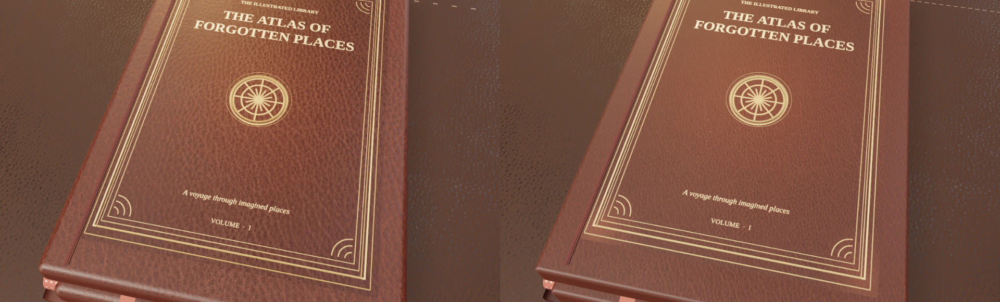

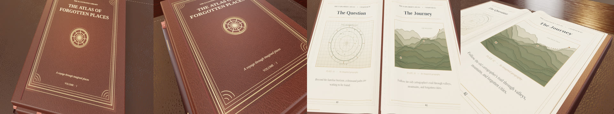

### r11 reference ledger and current limitations

| Source | Observed feature | Rights / confidence |
| --- | --- | --- |
| [National Library of New Zealand — The Book Beautiful](https://natlib.govt.nz/blog/posts/the-book-beautiful) | Smoothly polished calf versus deliberately grained goatskin, fine gold-tooling | Conservation/photo reference only; qualitative, high for leather identity |
| [Morgan Library — Calf leather binding](https://www.themorgan.org/exhibitions/online/holbein/calf-leather-binding) | Decorative stamped gold and raised foliate lines on an actual calf volume | Collection photograph for reference only; not the fictional atlas |
| [Fitzwilliam Museum — Re-covering a fifteenth-century binding](https://conservation.fitzmuseum.cam.ac.uk/recovering-and-re-covering-conservation-of-a-fifteenth-century-bookbinding-2/) | Board leather, spine/joint and interior turn-in repair construction | Conservation reference only; qualitative, medium for finish |
| [Poly Haven — Leather Red 02](https://polyhaven.com/a/leather_red_02), [Brown Leather](https://polyhaven.com/a/brown_leather), [Wood Table 001](https://polyhaven.com/a/wood_table_001) | Actual locally bundled photo PBR scans, source map correlation and normal response | CC0 reuse-authorized; existing provenance manifest; high for source identity |

These are material and craft references, **not registered views of the same
book**. The new wear and turned-in leather are original interpretations,
not a historic conservation replica. The blotter's grain/finish, lack of
individual loose stitch fibre, flat board faces, limited gold-leaf cracking,
unphysical hinge flexibility, real lens effects and light bounce still limit
macro photorealism. A human side-by-side reference approval and complete r11
film export are still outstanding.

### r11 verification

- **170 unit files / 2,292 tests passed** with the established 15-second
  per-test cap. **19 focused 3D book tests passed**, including scan tiling, separate spine
  material, bookbinder turn-in, calibrated desk-scale UVs and saddle-stitch
  geometry. The r10 textblock/leaf clearance raycasts remain green.
- TypeScript, scoped ESLint, Storybook production build, source preflight,
  catalog (**383 entries / 829 stories**), hero evidence gate and export
  preflight passed. The hero gate still reports **0 human-approved assets**;
  this is not a photorealism certification.
- Real Chrome/WebGL captured four photo-material macro views, including the
  new oblique raking shot. The image comparison uses the **identical** cover
  camera for r10 (left) and r11 (right); no Blender cube render is substituted
  for the Three.js film.
- The new scenes have not received a complete 300-frame encode, acoustic
  playback or mobile review; r09 remains the latest fully verified film.

## r10 continuation — curved textblock and articulated board joint

**Status: draft / multi-view visual HOLD.** The r09 photographic materials
already looked convincing on the closed cover, but the opened book still had
flat, unsupported paper slabs. The first r10 trial revealed a *new* visual
failure: bending paper stacks pierced the printed leaves and appeared as pale
vertical bars in actual Chrome/WebGL closeups. The final trial aligns the
instanced geometry with the parent folio's fold coordinate and checks the
clearance with downward 3D raycasts over eight transverse positions and three
film frames. No screenshots were accepted from the faulty trial.

- Each of the 96 textblock strata now has a closed, subdivided paper volume
  following the gutter/shoulder/fore-edge relief, mirrored about the spine;
  each leaf stays on top of its corresponding supporting stack. This restores
  a physical side contour for grazing light and partial close-up views.
- A narrow recessed **French groove** and rounded leather lip follow the
  rotating front hardcover board. This gives the board/spine junction an
  actual shadow-producing transition rather than a printed ornamental line.
- The exposed fore-, head-, and tail-cuts now use 1K **photographed paper-edge**
  color/normal/roughness maps from [Poly Haven's CC0 encyclopedia-book scan](https://polyhaven.com/a/book_encyclopedia_set_01),
  with each axis oriented so the stratification follows the stack thickness.
  The material is restricted to the cut edges; printed pages remain original.
- Two additional Storybook QA views reveal the low-angle shoulder/fanning
  profile and the turning leaf's relationship to the supporting stack.
  Inspect the actual rendered angles, not the test counts alone.
- A third **photographic fore-edge macro** in Storybook checks the scanned
  page cuts at grazing light; the three-image material strip shows cover,
  spread and edge view in that order.
- Chrome/WebGL stills and photographic-material screenshots were rerendered
  after the clearance fix. The proof below compares **r09 on the top row** and
  **final r10 on the bottom row** at the same closeup story cameras.

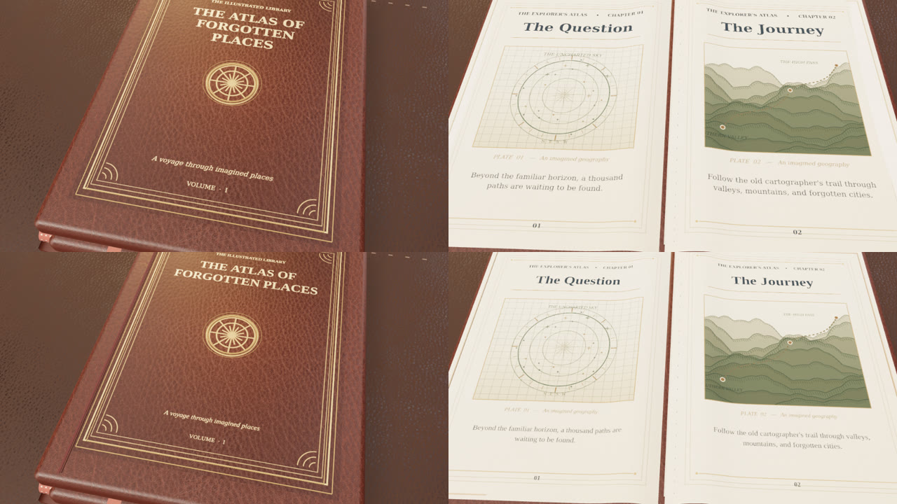

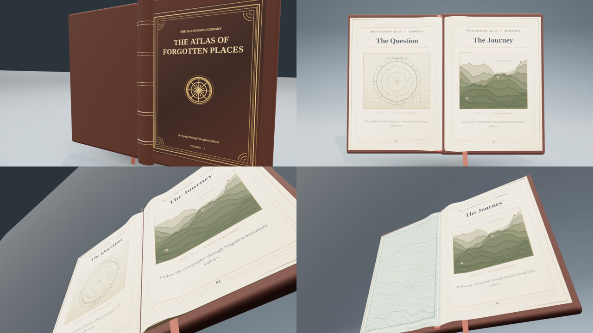

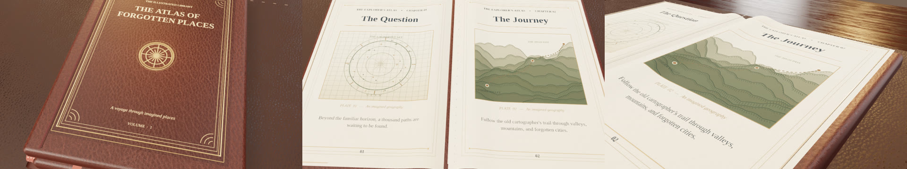

### r10 reference evidence ledger

| Source | Observed feature | Use / confidence |
| --- | --- | --- |
| [University of Illinois, *Preserving Books in Your Home Library*](https://www.library.illinois.edu/preservation/wp-content/uploads/sites/77/2024/05/preserving-books-in-your-home-library.pdf) | Labeled shoulder, inner joint, headband, folded sections and the relationship between boards and textblock | Technical construction reference only; high for anatomy, no target-specific dimensions |
| [The Met, *The Fragility of Joints and Hinges*](https://www.metmuseum.org/perspectives/joints-and-hinges) | Thinned flexible leather at external joints and cloth/paper inner hinge | Conservation reference only; high for materials and functional distinction |
| [American Institute of Physics, *Handling Rare Books*](https://www.aip.org/library/handling-rare-books) | Real open historic book, fanned/curved paper and spine contact | Photographic reference only; medium, uncontrolled camera |
| [Library of Virginia, CCRP conservation gallery](https://www.lva.virginia.gov/services/ccrp/grants) | Historical volume hinge and layering at side view | Photographic reference only; medium, uncontrolled camera |

These depict **different books**, not a scanned original of this fictional
atlas. No external photograph, book scan or third-party model was copied into
the scene. The book is an original cinematic prop, not a conservation-accurate
reconstruction of one historical object. Photo cameras are not registered to
our mesh, so these are qualitative craftsmanship checks, not silhouette-IoU
or measured photo-likeness claims.

**Unresolved:** The hero still has a boxlike, overly planar open silhouette
under some camera angles. The leather case has a board-attached crease but no
fully simulated flexible hinge deformation, while the signatures do not have
real sewing thread/fold topology or paper transmission. WebGL lighting lacks
path-traced bounce, optical depth of field and microscopic edge fibres.
The user-visible book remains a WIP until those physical cues and the
normal-speed/phone playback review are addressed.

### r10 technical verification and export status

- Blender CLI **4.0.2** was installed and its headless render plus glTF/GLB
  exporter independently smoke-tested. The actual book continues to be authored
  and rendered in Three.js/WebGL; the Blender smoke cube is **not** a book GLB.
- **170 unit files / 2,290 tests passed**, including new real-mesh clearance
  raycasts and the moving French-joint/material-map regressions. TypeScript,
  scoped ESLint, Storybook production build, video export-core tests and catalog
  check all passed. Catalog: 383 components / 828 Storybook stories.
- Storybook captured real Chrome/WebGL construction and photographic macros.
  The human-approved hero quality gate still reports **0** approved assets;
  this draft does not claim an independent photo-faithful signoff.
- A fresh 300-frame r10 H.264 film export was attempted. The first 60-frame
  segment was encoded and independently counted at **960×540, 30 fps**.
  Subsequent capture was intentionally interrupted because software WebGL
  rendered slowly in this environment. **No r10 full-length MP4 is published**;
  the [previous verified r09 movie](assets/everyday-3d/epic-book-r09-landscape.mp4)
  remains the current complete film, and the newly authored r10 shots remain
  visible in Storybook and the images above. A complete new export and acoustic
  full-speed review are still required.
- The all-project `npm test` command completed **all 2,290 unit tests** but
  exited nonzero while initializing the separate Storybook browser project:
  its bundled Playwright headless-shell binary was unavailable. Real Chrome
  was supplied explicitly for the visual captures; the Storybook browser
  test project was not claimed to pass.

## Visual research (inspiration only)

- [University of Illinois — anatomy of a book](https://www.library.illinois.edu/prescons/services/collections-care/book-anatomy/): headband, case and textblock relationships.
- [The Metropolitan Museum of Art — bindings and hinges](https://www.metmuseum.org/): structural separation between leather case, spine and signature block.
- [Canadian Conservation Institute — care of books](https://www.canada.ca/en/conservation-institute/services/preventive-conservation/guidelines-collections/books.html): restrained page motion and physical handling.
- [Library of Congress — book preservation](https://www.loc.gov/preservation/): paper and aging reference, not scanned imagery.
- [Freesound](https://freesound.org/) and [Pixabay](https://pixabay.com/sound-effects/): material-sound research only; no downloaded samples.
- [Library of Congress — antique atlas](https://www.loc.gov/resource/g3700.ct003961/?st=grid): engraved graticules, map marginalia and lettering hierarchy.
- [Library of Congress — illustrated mountains and rivers](https://www.loc.gov/resource/g3200m.gcw0013960/?sp=6): relief hachures and fine-line route notation.
- [The Met — historic binding](https://www.metmuseum.org/art/collection/search/841587): gilt tooling, leather surface and raised-band rhythm.

## Reproduction

```sh
node scripts/build-epic-book-audio.mjs dist/epic-book-r05/audio
npm run build-storybook
node scripts/serve-static.mjs storybook-static 6006
KUMIKI_BROWSER_EXECUTABLE=/path/to/chromium npm run video:export -- \
  --story=video-production-scene-templates-3d-everyday-objects--epic-book-storytelling-capture \
  --frames=300 --segmentSeconds=2 --audio=dist/epic-book-r05/audio/mix.wav \
  --output=dist/epic-book-r05/epic-book-landscape.mp4
```

The film uses the existing frame-addressable `VideoExportStage` and its
verified FFmpeg encoder. The two track stems and `cues.json` are reproducible
from `scripts/build-epic-book-audio.mjs`; files under `dist` are ignored build
artifacts. The source remains independent of a stock-audio license.

## Quality gate

- Automated: unit tests for named physical details, 96 strata, seek identity,
  portrait camera and existing 3D scene behavior; TypeScript; ESLint; real
  export's decoded frame count, duration, aspect ratio, audio and contact sheet.
- Human signoff: play the *actual encoded film* at normal speed, muted and
  audio-only, including phone-size portrait review. Examine binding and page
  occlusion for temporal popping, z-fighting or unintentional desk collision.
- A clean automated result is technical validation, not a claim of full
  photorealism, award-level craftsmanship or human-approved cinematic quality.

## Render review

The first six-frame actual-WebGL proof (`r01`) exposed a distracting center
spine that rose *above* both open sheets, like an oversized gilded clasp.
`r02` moves the structural leather case and sewing ribs **behind** the
textblock and leaves only a fine linen hinge at the page fold. A regression
test now checks the relative geometry depths.

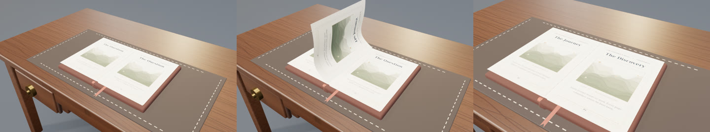

At the sampled opening/turn/final poses the binding no longer covers the
page artwork; the turning leaf stays curved and the heritage desk does not
intersect the book. Original foley/music is mixed at −22.5 LUFS integrated,
−10.4 dBFS true peak, measured from `dist/epic-book-r02/audio/mix.wav`.

The initial portrait proof exposed edge clipping once the hardcover opened;
the subsequent wide-FOV camera and cover-synchronized pan were inspected at
frames 0, 150 and 299. The full spread now remains within the 9:16 canvas.

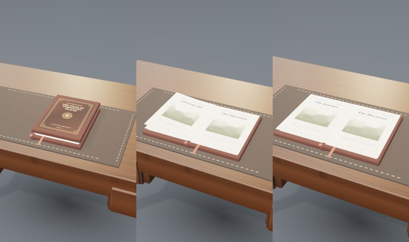

The `r05` pass gives each chapter a different original engraved composition.
The opening chart is concentric navigation geometry, the journey traces a
mountain route in directional hachures, and the discovery follows a coastline
past a small inked observatory. The textures are created deterministically
with Canvas2D; they are not scanned, downloaded or sampled from the references
above. Source-provided images still supersede the generated plate.

The exact-frame landscape proof caught mirrored typography on the *back* of
the folding sheet, invisible in the early static tests. Each verso now has a
separate horizontally reversed UV texture so the words read correctly after
the leaf swings to the left. At frames 118, 150 and 250 the page reads in the
correct direction. A regression test covers the back UV transform; a second
test covers a one-sheet book and a third checks continuous portrait framing.

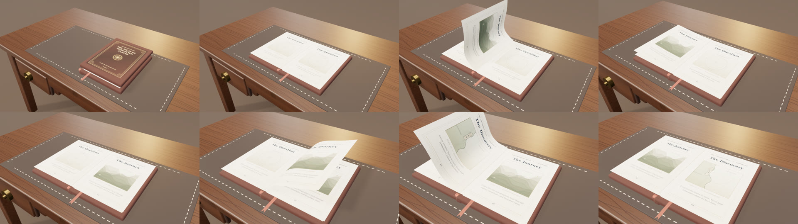

The final 9:16 lens moves substantially closer and uses a gentler camera
target change so the textblock fills the phone frame and the opening cover
remains visible.

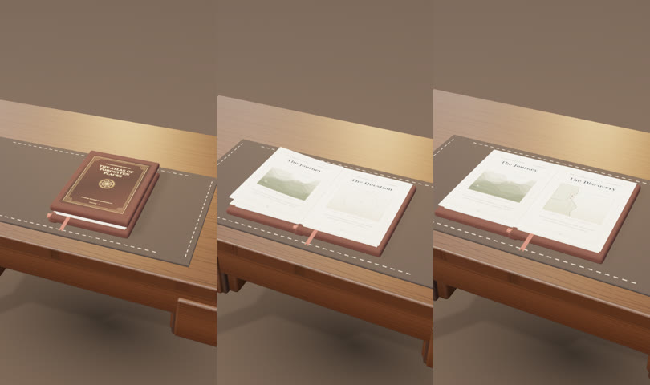

### Final encoded proof

[Download/play the full r05 H.264/AAC film](assets/everyday-3d/epic-book-r05-landscape.mp4).
The pipeline successfully decoded and verified all **300 frames** at
**960×540 / 30 fps / 10.000 s**, with 48 kHz stereo AAC. Its SHA-256 is
`68abd804a3d3a1a8bb4dc80f3defea65279253def54ed29b7d4394b06a9bc963`
(1,634,109 bytes). Five segments were rendered and validated before the
final remux; no unverified partial was promoted.

The *encoded* film was independently sampled at one-second intervals, not
merely previewed in the browser:

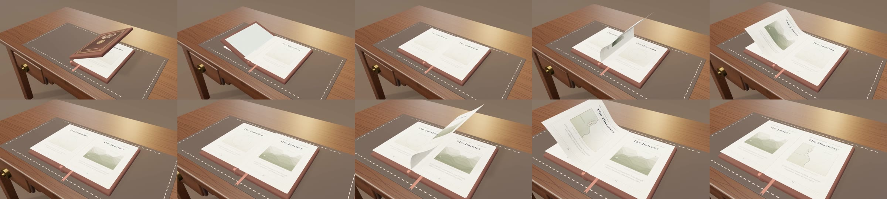

An adjacent-frame screen of the decoded film at 120×68 found 299 frame
differences. Their maximum mean absolute brightness change was **2.707**
levels on a 0–255 scale, and none exceeded 10. FFmpeg `blackdetect` found
no black-frame intervals. This detects gross whole-frame flashes, but can
miss small-area texture flashes; exact-frame snapshots above cover the
turning faces.

**Remaining review:** human playback at full speed, especially on a phone,
is still required before claiming final cinematic quality approval.

## r07 continuation — close-reading and page-continuity pass

The previous render was structurally valid, but the finished book was small
against the full walnut desk, particularly before the cover opened in portrait.
The standalone `PhysicalBookHero3D` lens also differed from the actual
`Everyday3DScene` film lens, so its independent preview did not reliably
represent the exported scene.

The two adapters now consume **one frame-addressed camera evaluator**.
Its pullback tracks the physical front-board hinge: a close, centered closed
cover moves to a wider view only as the page block doubles in width. Five
representative film frames in both aspect ratios are projected through a real
Three.js perspective camera against the *currently visible* mesh bounds;
their corners must remain in the safe viewport and the hero must occupy a
minimum portion of the shot. This is a geometry test, not a beauty score.

The first actual r06 film captures revealed two further aesthetic defects:
the pale flat mint endpaper barely showed its marbling, and the narrow
semi-transparent atlas lines disappeared at 960-pixel output. r07 restores
readable darker etched cartography and a combed mineral-pigment endpaper.
The oxblood cover also has micro-relief across its printed surface and actual
raised gilt perimeter fillets, with restrained burnished edge glazes on the
fore-, head- and tail-cut paper.

The filmed first page turn exposed a continuity error: the reverse of the
turning sheet showed *the next* chapter, while the stationary right leaf
still showed the preceding one. The sheet's verso now retains its chapter;
the next illustration is revealed beneath it as it lifts. The entire settled
spread remains unchanged across frames **163 → 164**. A regression test
asserts the front/verso texture identity and stationary-page material before
and after the settle beat, including out-of-order seeks.

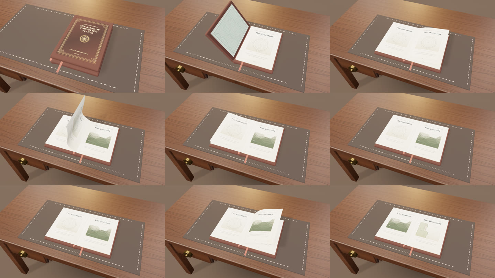

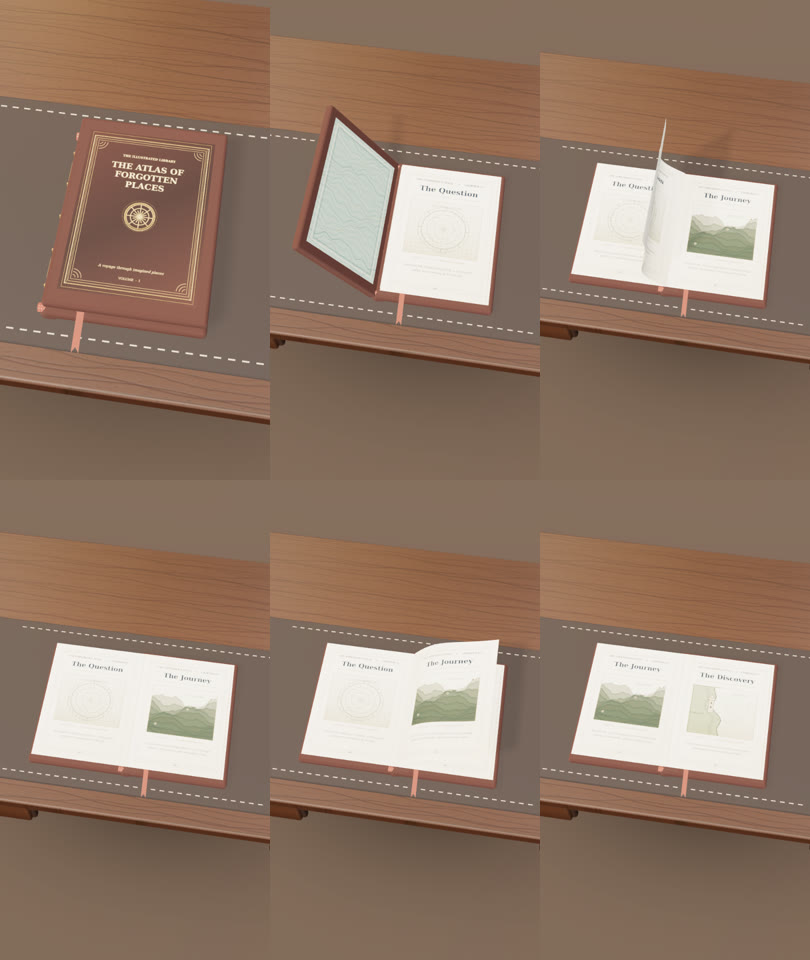

### Review status

- Actual WebGL captures inspected at landscape frames 0, 35, 85, 118, 150,
  163, 164, 215, 299 and portrait frames 0, 35, 118, 164, 215, 299.
- Real-source provenance remains unchanged: all art, materials and soundtrack
  are original procedural work. Illinois preservation diagrams and LOC
  engraved atlas references were **inspiration only**; none was bundled.
- Focused tests: **24/24 passed**, across the book and Everyday 3D suites;
  TypeScript typecheck, scoped ESLint, Storybook production build, catalog
  check (**383 entries**) and hero evidence gate passed. The evidence gate
  correctly reports *zero* human-approved assets, not an approval.
- Open artistic limitation: a stylized Three.js hero cannot yet claim
  photorealistic calf leather or photographic paper fibre detail. The broad
  repository lint command also reports errors in unrelated existing files.
  Formal human sound/phone playback approval remains outstanding.

### r07 full encoded film and temporal check

[Play/download the revised 10-second H.264/AAC film](assets/everyday-3d/epic-book-r07-landscape.mp4).
This is a fresh 300-frame export from the r07 source, not a copy of the r05
film. The original score and paper foley were rebuilt and synchronized at
48 kHz stereo. All five 60-frame segments passed decode verification before
the final remux.

- `ffprobe`: **300/300 frames**, 960 × 540, 30 fps, **10.000 seconds**, AAC
  stereo 48 kHz. File size **1,120,549 bytes**.
- SHA-256: `eb62cc221e86d120e249e7f31fa949e7e54bf84d3f7becbc4db3dd66d38599cf`.
- FFmpeg `signalstats` over 120 × 68 decoded frames: **maximum YDIF 3.199**;
  no adjacent pair exceeded 10. `blackdetect` reported no black intervals.
  These are screens for gross frame-wide flashes, not subjective visual QA.
- Repository-wide unit tests: **170 files, 2,283 tests passed**. The isolated
  registry-install smoke check staged **213 items / 3,037 files** successfully.

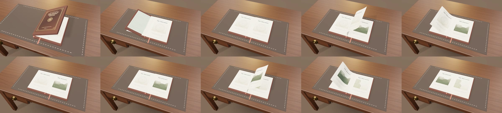

The reviewed WebGL stills above are complementary to this encoded film.
Human playback with sound at full speed and phone-size portrait review is
still required before changing the PR from draft to artistically approved.

## r08 structural reconstruction — what the references exposed

The r07 ornament passed the existing tests, but did **not** give the book a
convincing internal structure. Its open pages were flat print planes, the
entire 96-leaf textblock stayed on the right after turning, and the first
opening showed the same chapter on both sides. The leather spine and bands
were individually beveled boxes rather than a continuous rounded-back arch.
Adding more gold decoration could not fix any of these mismatches.

### Source photographs and construction evidence

All of these are **inspiration / anatomical study only**; no photographic or
third-party model pixels, topology or textures were copied into the library.

| Reference | What it revealed for our construction |
| --- | --- |
| [The Met — leather joints and inner hinges](https://www.metmuseum.org/perspectives/joints-and-hinges) | The exterior flexible joint and pasted-down interior hinge connect the moving board to the spine; the paper is not a rigid extension of either cover. |
| [NEDCC — sewn gatherings and laced-in board structure](https://www.nedcc.org/free-resources/preservation-leaflets/7.-conservation-procedures/7.6-conservation-treatment-for-bound-materials-of-value) | Individual folded folios form sewn sections, and sewing supports attach the textblock to the boards. |
| [Princeton Library — historic endbands](https://static-prod.lib.princeton.edu/visual_materials/hb/cases/endbands/index.html) | Endbands sit at the head/tail of the *textblock spine*, often partly under the leather endcaps; they are not ornament across a page surface. |
| [Gleeson Library — classic rounded-back binding](https://usfblogs.usfca.edu/gleeson-gleanings/2015/10/16/classic-rounded-back-binding/) | The arched back, shoulders and laced-in boards establish the silhouette in three-quarter views. |
| [Poly Haven — CC0 encyclopedia model](https://polyhaven.com/a/book_encyclopedia_set_01) and [brown leather PBR texture](https://polyhaven.com/a/brown_leather) | High-resolution material/edge-closeup comparisons. **Reference only** in this pass; no external binary assets were imported. |

### Actual mesh and timeline changes

- `book-binding-geometry.ts` constructs a contiguous extruded leather spine
  with endcaps, arched raised leather bands and restrained separate gilt
  fillets. The paper now uses subdivided signed-left/right surfaces with
  a low central sewing fold and higher paper shoulders.
- The 96 individually instanced paper strata are allocated between **two**
  independently posed stacks. Turning leaves transfer mass from right to
  left, preserving all 96 strata on every frame; fore-, head- and tail-edge
  glazes follow each visible stack's changing thickness.
- The first opening displays the marbled pastedown on the left and chapter
  one on the right. A turned verso becomes the left page; the next chapter
  remains the right leaf beneath the turn. The pose is evaluated from the
  requested absolute frame, including out-of-order seeks.
- Storybook now has isolated **Binding Inspection** and **Folio Inspection**
  views so underside spine geometry and the leaf shoulders can be reviewed
  independently of the editorial desk camera. The actual WebGL film stills
  below are fresh r08 renders, not recycled from the previous video.
- The browser PNGs at settle frames **163 and 164 are byte-identical**
  (SHA-256 `36aa4254f756425bafa882cf0d04f4ff8f36556cbabc56ef694556e33610f5`),
  demonstrating that the new stack poses do not flash at that boundary.

Matched-camera comparison — **r07 at left, r08 at right**; frame 85 in the
top row and settled frame 164 in the bottom row. The first spread now reveals
the endpaper, while the later spread has a deeper, raised paper shoulder.

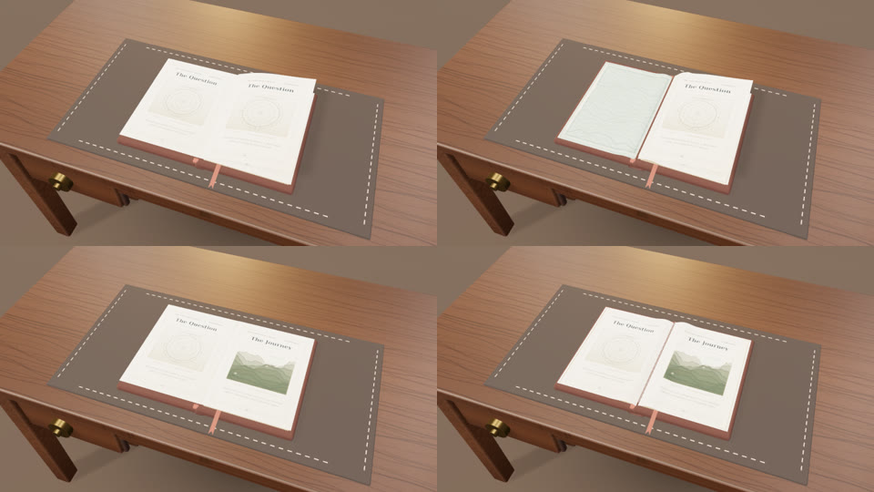

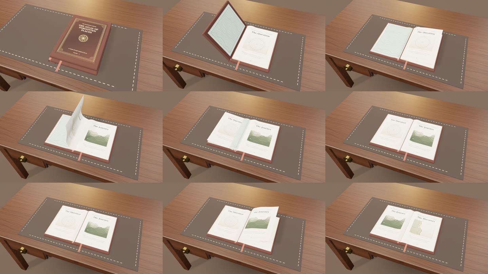

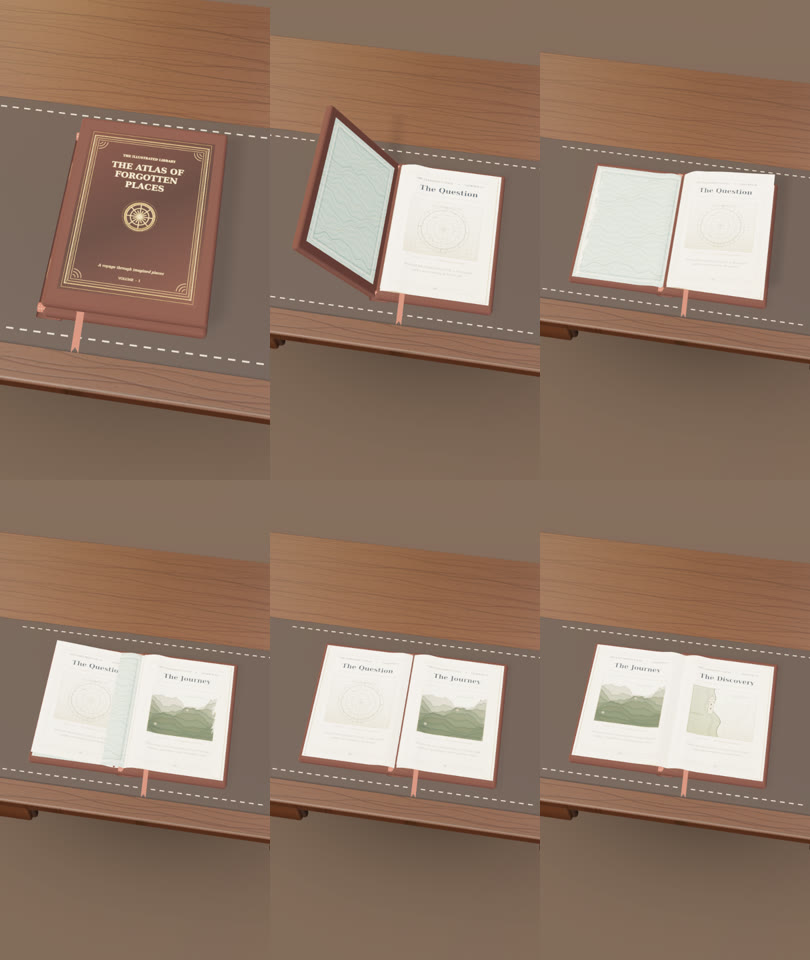

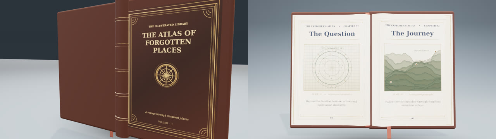

This remains **stylized / in progress**, not photo-faithful: a true flexible
leather joint, sewn gathering folds and paper-fibre normal/roughness maps
still need their own authored geometry/material evaluation. The historical
inspiration photos also show varying book eras and construction systems;
this is a plausible fictional rounded-back edition, not a conservation-grade
replica of any particular artifact. Each illustrated chapter turn compresses
more than one physical signature into one editorial beat; matching literal
single-leaf page count and section sewing requires a separate animation mode.
The current 3D bridge also repeats the chapter plate across a leaf's two
sides; a future authored folio-pair schema should support distinct recto and
verso engravings without inventing or mirroring chapter content.

### r08 verified full film

[Play/download the reconstructed r08 H.264/AAC film](assets/everyday-3d/epic-book-r08-landscape.mp4).
This is a **new** 300-frame WebGL export from the reconstructed model, not a
renamed r07 video. Five 60-frame segments rendered and passed the exporter's
decode checks before the AAC soundtrack was remuxed. The unchanged original
soundtrack was rebuilt in `dist/epic-book-r08/audio`; its SHA-256 matches the
previous deterministic mix exactly (`0f2c1d77f953a69de5c44976537da77793def222a7b1358996aab7d062d6b77b`).

- `ffprobe`: **300/300 decoded frames**, H.264 960 × 540 at 30 fps, 10.000 s,
  AAC stereo 48 kHz; **1,177,376 bytes**.
- Movie SHA-256: `a5598ad234e86c4cf181cad238da4acddd2cd23563ea947f5978ff29fcede077`.
- Independently decoded `signalstats` on 120 × 68 frames: **maximum adjacent
  luminance difference 3.198/255**, zero pairs above 10. `blackdetect`
  emitted no black intervals. These metrics screen for gross flashes; they
  do not certify small-area texture stability or artistic quality.
- Frame-accurate 300-frame export: **837 seconds** wall time on this shared
  software-WebGL renderer; this is offline encoding time, **not** a measured
  interactive GPU frame rate.
- Full unit suite **170 files / 2,286 tests passed** with 15 s per-test timeout;
  TypeScript, scoped ESLint, Storybook, catalog (**383 items / 823 stories**),
  registry smoke (**213 items / 3,037 files**), and export-core tests (**18**)
  passed. Hero quality gate correctly recorded **zero human-approved assets**.

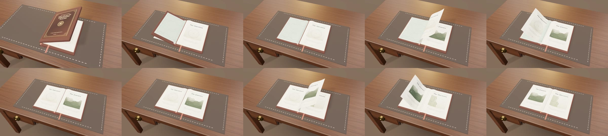

Independent reproduction from source:

```sh
node scripts/build-epic-book-audio.mjs dist/epic-book-r08/audio
npm run build-storybook
node scripts/serve-static.mjs storybook-static 6006
KUMIKI_BROWSER_EXECUTABLE=/path/to/chromium npm run video:export -- \
  --story=video-production-scene-templates-3d-everyday-objects--epic-book-storytelling-capture \
  --frames=300 --segmentSeconds=2 --audio=dist/epic-book-r08/audio/mix.wav \
  --output=dist/epic-book-r08/epic-book-landscape.mp4
```

**Release status remains draft:** human viewing at normal playback speed,
with audio and on a real phone, is required before artistic acceptance.

## r09 — photographic surface reconstruction (still WIP)

The user review of r08 identified the decisive remaining visual gap: the
silhouette and binding were plausible, but the walnut desktop and leather
still looked painted. Macro detail could not emerge from thousands of
Canvas2D speckles lit by a uniformly bright studio. The r09 pass replaces
the highest-visibility *material inputs*, not the deterministic geometry.

### Material provenance and treatment

The following three [Poly Haven](https://polyhaven.com/) assets were checked
against their [CC0 license](https://polyhaven.com/license) on **2026-11-01**.
Each has independently authored color, OpenGL normal and roughness maps;
locally optimized copies total roughly **4.9 MB**. Full authorship, source
URLs, processing and file-level provenance are recorded in
[`src/components/video/assets/epic-book/PROVENANCE.md`](../../src/components/video/assets/epic-book/PROVENANCE.md).

| Material | Actual scanned source | In-scene treatment |
| --- | --- | --- |
| Calf-leather cover, spine and boards | [Leather Red 02 — Rob Tuytel](https://polyhaven.com/a/leather_red_02) | Color/normal/roughness PBR at matched UVs; warm oxblood glaze; separate metallic-foil typography with readable underprint |
| Varnished desk | [Wood Table 001 — Dimitrios Savva and Rico Cilliers](https://polyhaven.com/a/wood_table_001) | Real growth lines and pores, rotated to the long desk axis; restrained lacquer and surface normals |
| Worn writing mat | [Brown Leather — Rob Tuytel](https://polyhaven.com/a/brown_leather) | Grain repeated to approximate the mat's physical span; subdued rough sheen and much finer dark stitches |

The browser decodes all nine locally bundled maps *before* mounting the WebGL
hero, so a frame seek does not asynchronously swap a color, normal or
roughness map halfway through a take. The non-DOM `createBookHero3D` still
supports its procedural fallback for tests and general composability.
The page print preserves its authored cartographic plates and gains
fine deterministic paper-specific roughness/normal variation. The camera is
slightly closer and recentered, with all five protected film poses passing
the same landscape/portrait viewport-bound guard.

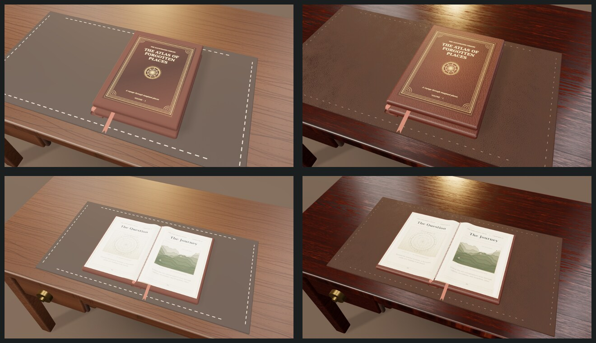

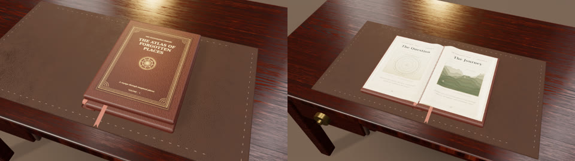

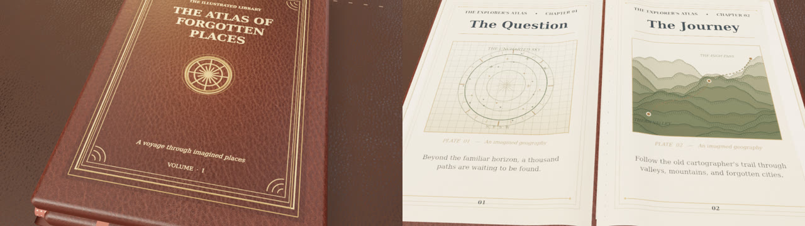

### r09 independently decoded film

[Play/download the new r09 H.264/AAC film](assets/everyday-3d/epic-book-r09-landscape.mp4).
All **300 frames** were exported from this revision's real WebGL scene,
in five 60-frame segments; the first two segments were independently
verified and reused after a rendering-session interruption, and the final
three were freshly rendered. The exporter verified the concatenated film,
then an independent `ffprobe`/FFmpeg pass confirmed:

- **300/300 decoded video frames**, H.264 **960 × 540 at 30 fps**, **10.000 s**,
  AAC stereo **48 kHz**, **1,737,691 bytes**.
- SHA-256: `f4454c966f8c0176ee260a179919b9d7dc67712ca891c1e1a65551f721ef3f54`.
- Independent `signalstats` on 120 × 68 decoded frames: maximum adjacent
  mean luminance difference **3.779/255**; **zero** pairs above 10.
  FFmpeg `blackdetect` detected **no black intervals**. These screenings
  catch gross glitches, not minute texture flicker or artistic defects.
- The final resumed export used **457.1 seconds**; the first two verified
  segments were rendered in a previous attempt, so 457.1 seconds is **not**
  the full five-segment wall time.
- Final source checks: **170 unit files / 2,287 tests passed** with a 15 s
  per-test timeout; TypeScript, scoped ESLint, production Storybook build,
  catalog (**383 entries / 825 stories**) and exporter tests passed.

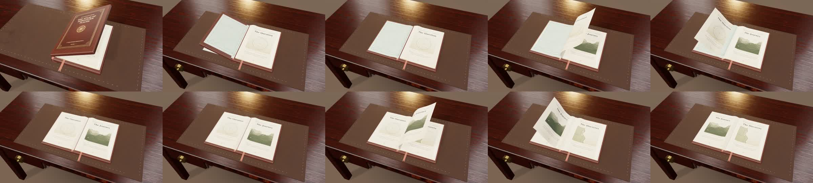

Artistic approval remains separate from machine QA: view the film with
sound at real speed and inspect on a physical phone before removing the
draft designation.

### What this does *not* solve

This should be judged as a **significant real-time PBR upgrade**, not
photo-matched realism. The page illustrations remain deliberately authored
engraved graphics, not scanned photographic plates. The old book still
lacks physically flexible leather joints, physically sewn folios, sheet-edge
transmission, cinematic depth of field, controlled lens bloom, soft multi-
bounce global illumination and a real tabletop/room HDR environment.
Those requirements are not solved by one more diffuse-map overlay; a
reference-matched, path-traced offline render pipeline and a shot-by-shot
comparison are the next distinct production phase. The source PR does not
contain the specific external reference video or its timecodes, so no claim
of a shot-for-shot visual match is made.


## r12 — relief-bearing exterior materials (render verification pending)

The printed leather and metallic leaf share a 112 × 144-subdivision deformed board surface with subtle compressive creases along the movable joint, diminishing wrinkles at cover turn-in corners, and shallow head/tail tension. The foil stays precisely 0.0016 local units in front of the ink; continuous analytical topography is deterministic under frame seeks. Dyed scuff marks and material roughness marks now share one seeded abrasion field, rather than unrelated positions. Photographic walnut gains restrained, rough clearcoat highlights.

**Status:** code and focused regression checks authored; the new rendered appearance and temporal continuity have not yet been independently inspected. This is not photogrammetry or a path-traced film.


## r13 — actual impressed gilt tooling + localized corner grain (pending visual QA)

Reference comparison: [AASLH/Conservation Center bookbinding terminology](https://download.aaslh.org/AASLH-Website-Resources/ccaha-an-illustrated-guide-to-book-terminology.original.pdf), [University of Adelaide hand tooling](https://www.adelaide.edu.au/library/collections-archives/ua/media/556/rb-webpage-cover-decoration-hand-tooling.pdf), [University of Chicago Library aged calf](https://www.lib.uchicago.edu/collex/exhibits/under-covers/conservation-older-materials/aging-leather/). In historic gilt tooling, gold adheres inside a **blind-tooled impression**, rather than thick raised modern piping.

The 240 × 320 cover surface now receives shallow geometrically evaluated stamping along three hand-tooled rectangles and the printed compass rings, registered to the *exact authored 1024 × 1400 canvas coordinates*. The two thin physical foil fillets use matching art-template positions; the former oversized raised rectangles and wide torus have been replaced with much finer metallic glints. The full leather-and-foil shell is lowered closer to the board face while keeping the 0.0016 local-unit separation. Corner wear now includes separate directional exposed-fibre micro-scratches and matched albedo/roughness response. Additional regression samples check stamping registration and bounds.

**Caution:** analytic detail is approximate and intentionally restrained; visual comparison must confirm that the recessed lines read at film resolution and do not z-fight or shimmer under camera motion. No external book imagery or restricted geometry was copied into the product.


## r14 — desk and blotter, not just the book (verification pending)

Studying the original walnut scan revealed that the grain runs vertically in the image. The tabletop deliberately rotates it lengthwise, but reusing that material on the tapered legs incorrectly turned their grain sideways. The desk now assigns a **separate, physically scaled vertical PBR grain triplet** to the four tapered solid-walnut legs, while preserving tabletop grain alignment. Two restrained joined-board seams break the implausible seamless desktop without creating prominent strips. The leather blotter now has four burnished rolled returns outside its saddle-stitch rows; microscopic dark perforations beneath every stitch restore the thread-to-hide connection. All extra geometries and materials are disposed with their hero composition. A dedicated test checks per-part grain orientation, edge rolls, perforation counts, and restrained joint opacity.

**Follow-up:** verify leg direction, material scale, seam visibility, and stitching at macro distance in real WebGL renders. This remains GPU PBR, not offline ray-traced photography.
