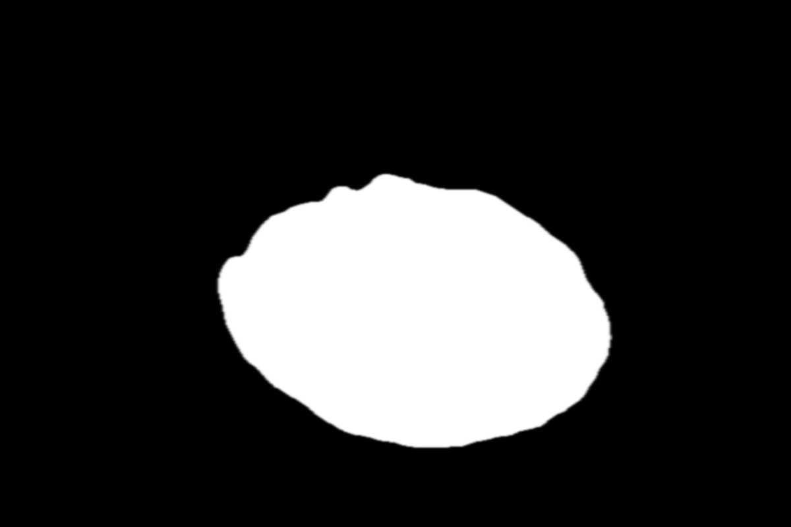
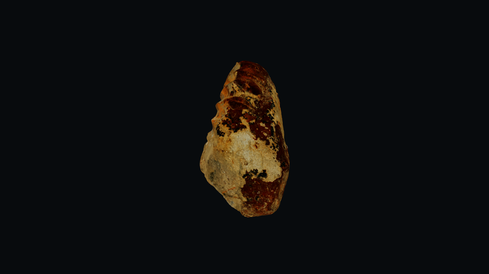
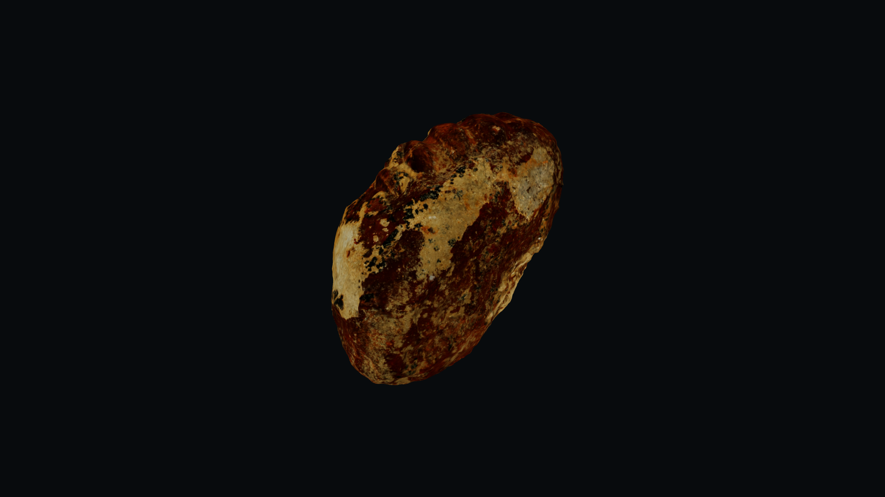
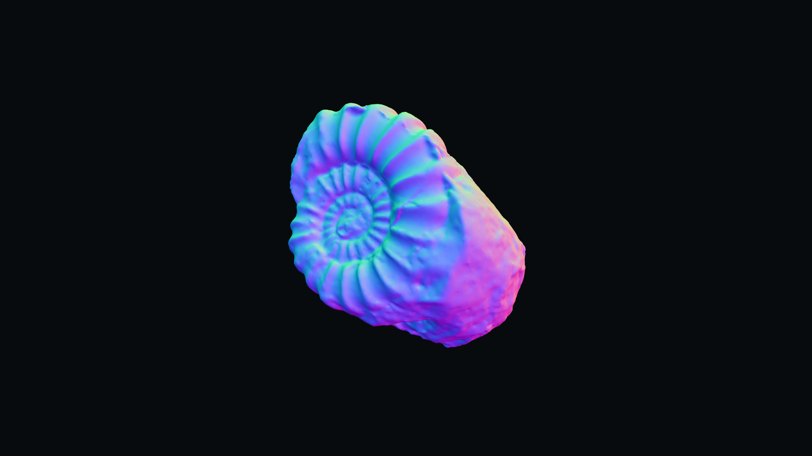
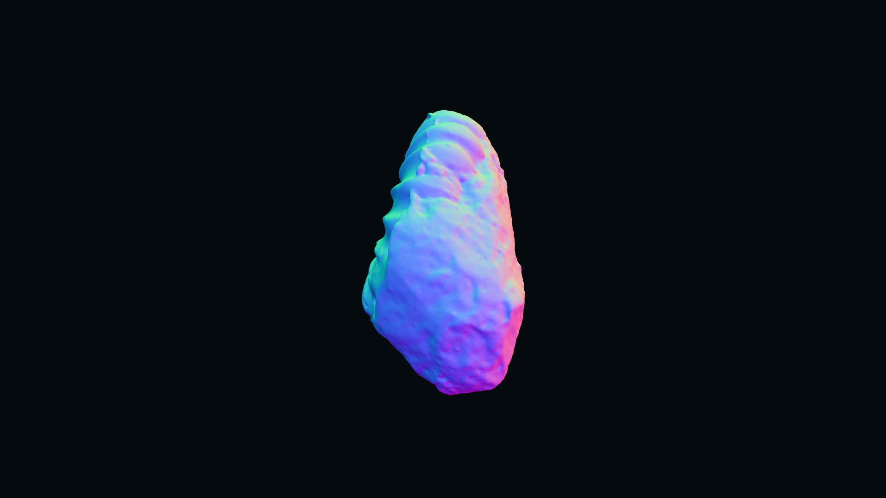
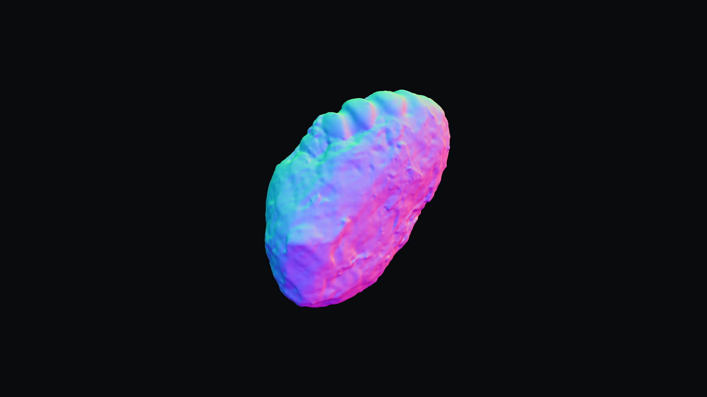
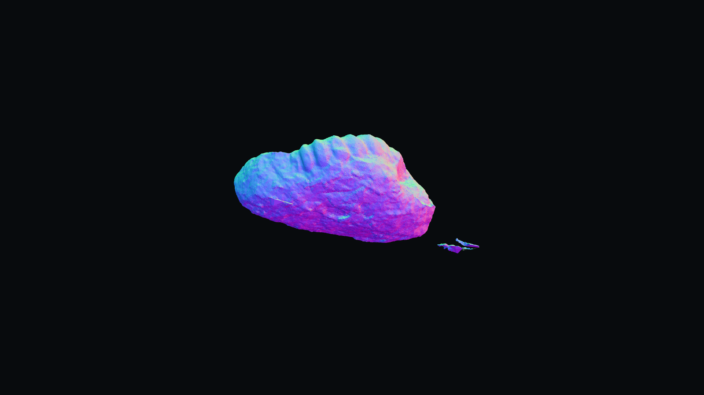
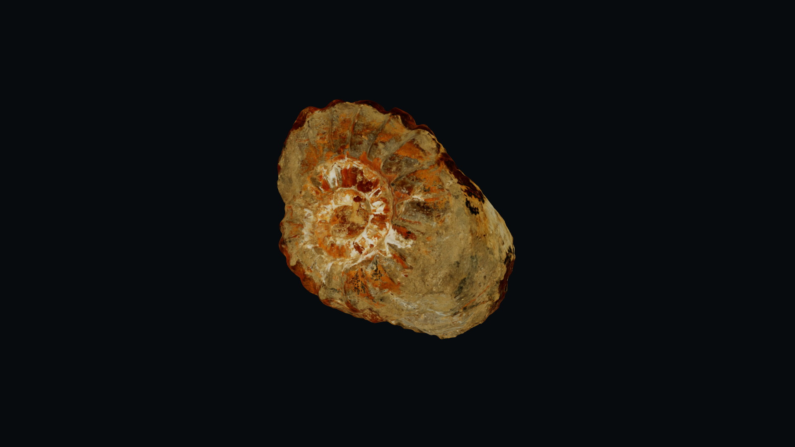
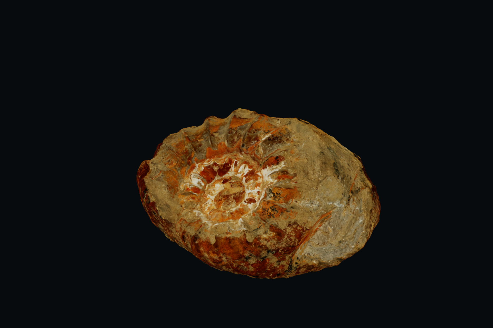
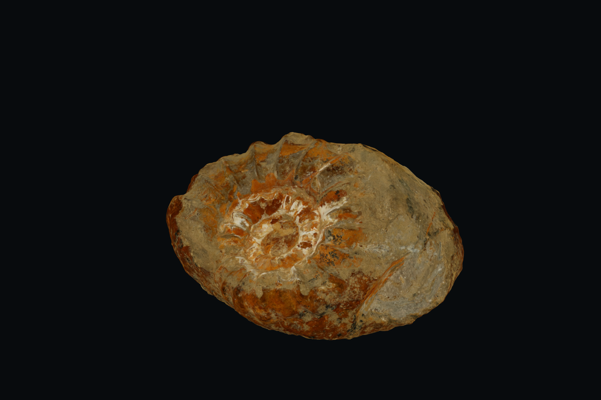

# Multi-view scene benchmark — 2026-11-02

**Status: native backend selected for initial implementation; final photographic-fidelity acceptance pending.**

## Real source and fixed split

[Original MNHNL source dataset](https://data.public.lu/en/datasets/3d-reconstruction-of-a-fossil-vre-gpr21-via-photogrammetry/), published by Musée national d’histoire naturelle Luxembourg, explicitly licenses the original photographs and derived files under [CC BY 4.0](https://creativecommons.org/licenses/by/4.0/). Raw source data is not MIT-licensed. Preserve attribution in redistributed derivatives.

- Downloaded original JPEG archive: 930,385,482 bytes.
- SHA-256: `0b683f51ab97b4503fc7b8d781f9979e352ff5b63e3f9141e7a19cf9f9a0ae33`.
- 226 image files; exclude `VRE-GPr21-001.JPG` after inspection because it depicts a color chart.
- Fixed 202 training / 23 held-out photos. Held-out photographs were not supplied to either reconstruction frontend.
- Source photographs are 6960×4640. Preserve the encoded originals; benchmark downsampling inside a backend is recorded separately.
- The subject changes orientation, includes side/back views and sits against dark backgrounds. Some views include rulers and supports. This is a demanding object-isolation benchmark, not a claim that arbitrary capture modes already work.
- Exact per-photo hashes, excluded files and split are in `src/craft/fixtures/image-scene/sources.json`; reproduce using `benchmark_capture.py`.

## Machine and actual tools

Apple M4, 10 CPU cores, 24 GiB RAM, macOS 26.6.2 (25G83), arm64; approximately 49 GiB free disk at start. Swift 6.4, Blender 5.2.3 LTS, FFmpeg available. RealityKit `PhotogrammetrySession.isSupported` returned true.

| Candidate | Actual execution | Current outcome |
| --- | --- | --- |
| Apple RealityKit Object Capture | Real 202-photo reconstruction, medium detail, automatic object masking requested | Completed; 50,000 triangles and 4096² photographic texture; Three.js inspection described below |
| COLMAP 4.2.1 + OpenMVS 2.4.0 | Actual sparse alignment, 4,672,474 fused points and 865,659 mesh faces; geometry-only Three.js inspection | Fails baseline: detached fragments and noisy surface; texturing completed; geometry failure still rules out default use |

The OpenMVS release lacks the `CreateStructure` frontend described by the newer upstream wiki. The comparator therefore uses COLMAP for sparse alignment. Dense COLMAP CUDA stereo is not available on this machine. OpenMVS remains an external AGPL tool and is not copied into the MIT runtime.

## Acceptance card — fixed before optimization

Inspect front, side, three-quarter, back and macro views, including the orange/white fossil surface divisions, thin perimeter, cavities and chipped outer rim. Match original cameras where calibration supports it. Unregistered comparisons are qualitative; do not label them pixel-accurate evaluations.

The first moving benchmark must preserve recognizable surface detail and silhouette at 1920×1080, avoid detached rulers/supports, missing surfaces, doubled contours, obvious seams, stretched texture or texture swimming during the tested motion. Review an unlit/baked rendering so new physical lighting does not conceal defects. Run push-in, restrained orbit and oblique paths; limit camera motion to supported surfaces. Repeat with independently framed portrait output.

Do not adopt a backend because its mesh exported or unit tests passed. Record numerical tolerances after measuring the baseline and before parameter optimization, with source-registration uncertainty. Record human acceptance separately from measurements and author inspection.

## Execution evidence and revisions

- Preliminary automatic reconstruction included the color chart. It was terminated and restarted with that non-subject observation excluded. It is not a final benchmark artifact.
- Source contact sheet inspected before backend selection; rulers/supports and subject rotations identified for later mask/geometry verification.
- Capture preparation tests: 6 passed after observed missing-module failure. Tested deterministic split, preserved source hashes, rejected unsafe paths/duplicate names/content, incorrect archive digest, unknown exclusions, and existing-output protection.
- Native Swift boundary tests: 3 passed after observed missing-source compilation failure. Tests compile the real adapter, query supported hardware, and reject invalid arguments/missing inputs/output overwrite. These tests do not reconstruct or certify a mesh.
- Existing relief/composite baseline: 13 tests passed. Full existing unit baseline: 175 files / 2,330 tests passed (72.61 seconds).

### Foreground-isolation probe

A real local Vision foreground-instance segmentation probe on held-out view `VRE-GPr21-006.JPG` selected its largest non-background instance. The resulting grayscale mask was inspected against the source photograph: it excludes the separate ruler and retains the main fossil silhouette in this view. Fine chipped edges still need full-resolution boundary comparison; this single-view result does not certify every mask or the eventual reconstructed mesh. The held-out image was used only for this diagnostic, not reconstruction/texturing.

Mask image derived from the MNHNL photograph under CC BY 4.0; preview resized to 1200 px, no retouch. This is a mask diagnostic, not a scene render.

### First actual Three.js mesh renders

The native medium reconstruction completed and was converted from USDZ with Blender 5.2.3. Packaging emitted unresolved-reference warnings, but archive inspection confirmed all named texture files were embedded; Blender decoded the 4096×4096 color texture and the exported GLB contains it. The normal/AO maps are not used to simulate relighting. This prototype uses an emissive photographic material; the production converter should encode its baked capability explicitly.

These images were captured from the real reconstructed mesh through existing `loadGltfHero`, `CameraViewport3D`, `compileCameraPoses` and `VideoExportStage`, at 1920×1080 in Chrome. They are camera-frame samples from a 120° orbit, not source photograph overlays.

Author inspection: the fossil has genuine side/back volume and visible observed surface markings; rulers/supports are absent in these sampled views and no detached rectangular image planes are visible. The initial orbit frames are not calibrated against the held-out source cameras, so no pixel-registration or photographic-fidelity pass is claimed. Remaining risks include macro texture softness, edge detail, unsupported underside surfaces, and color/exposure differences. A full-detail native run with checkpoint and pose export has started for a detail comparison; CPU dense reconstruction is still running.

Derived mesh/render imagery: MNHNL, CC BY 4.0. See fixture NOTICE.md and sources.json.

### Geometry-only inspection

The same mesh was also rendered with `MeshNormalMaterial`, replacing the photographic material and using no source texture or normal map. Inspection shows actual reconstructed spiral ridges and side/back volume; the photographed surface pattern is not the sole source of the apparent relief. Fine pits and chipped edges still require the full-detail comparison.

### Moving export and independent technical checks

[Actual native-medium orbit MP4](native-medium-orbit.mp4) · [technical QA report](native-medium-video-qa.json).

The actual native-medium 120° orbit was exported through `scripts/export-video.mjs` and the existing shared frame protocol: 180 decoded frames, 1920×1080, 30 fps, 6.000 seconds, 930,120 bytes. SHA-256 `d867d4f944159bd4f234c92df34eef962ed3427237fe6d8eacc2a1b2e97fc5e4`. Export wall time was 29.8 seconds. The motion skill's `video_qa.py` decoded this final MP4 and reported technical pass; artistic status remains pending human review.

The CPU sparse model registered 201/202 training views, with 103,867 sparse points and mean training reprojection error 0.743025 px. A **separate copy** of the model/database was used to estimate the 23 held-out cameras by feature matching and image registration, without supplying them to reconstruction or texturing. That copy registered 225 images total (including the previously unregistered training image). These statistics evaluate sparse registration, not final mesh fidelity. Dense reconstruction and registered rendered comparisons remain open.

## Remaining evidence

- [x] First textured reconstructed mesh captured in Three.js; neutral shape and calibrated fidelity inspection remain pending.
- [ ] Original / held-out source comparisons with documented camera registration.
- [ ] Rendered push-in/orbit/oblique clips in actual Three.js.
- [ ] Mask and background-isolation review, including rulers/supports.
- [ ] Defect → correction → same-frame comparison log.
- [ ] Backend decision, time/memory measurements and final quality limits.
- [ ] Human photographic-fidelity review.

No public scene API, registry availability or completed pipeline is claimed by this benchmark record.

## Backend decision and remaining fidelity work

Select the native macOS boundary for the first supported local backend, based on actual reconstructed geometry, photographic textures, isolated silhouette and frame-addressed render evidence. This is a feasibility decision, **not human certification of photo-perfect output**. The browser consumer remains platform-independent; other local preparation backends must implement the same artifact contract and pass this benchmark before being advertised as supported.

The full-detail native run completed in 1,056.13 seconds: 202 source poses, 100,000 mesh triangles, one 8192×8192 photographic color map, no skipped/invalid-sample warnings. Generated roughness/AO/normal/displacement maps are not presented as measured physical materials. Current GLB conversion retains the photographic color surface; additional recovered displacement is not applied to the mesh. That limitation matters for extreme macro views.

The CPU comparator produced 4,672,474 fused points and 865,659 faces, but actual geometry-only renders expose detached fragments and surface noise. Its texture assignment took over ten minutes and the complete texture stage took 828.3 seconds. It finished just before the stop command, producing a 26 MB GLB; the geometry failure still rules out default use, since photographic texture cannot repair failed geometry. It remains a research comparator, not a supported production backend. A future CPU attempt needs explicit subject masks before alignment/fusion and a new rendered quality pass.

Held-out camera calibration exists independently, but native-to-calibrated-model alignment and source-color/edge residuals remain open. Carry these checks into the final comparison/defect task; do not claim a quantitative photographic-fidelity pass from the present screenshots.

## Implementation checkpoint

The pure capture/bundle contract is implemented and its eight focused tests,
TypeScript check and scoped ESLint passed. Per-photo segmentation/normalization
is implemented separately; four macOS boundary tests passed, including a real
photograph, preserved existing output, missing-file error and EXIF rotation
normalized exactly once without modifying the original. The one-call preparation
orchestrator, prepared-scene loader, camera presets/stage, Storybook registry
integration and final PR are still unfinished. Native prepared mask/depth ingestion
was connected in the follow-up increment recorded below. Do not treat benchmark artifacts as a completed pipeline.

The `native-calibrated-*.png` captures transfer held-out COLMAP camera poses
through the measured similarity transform in `native-to-colmap.json`. They are
experimental comparisons; rendered edge/color residuals and exact registration
uncertainty still need evaluation. The front inspection suggests geometry aligns
closely, but the current ACES rendering brightens the photograph. The follow-up increment below implements
a generic `linear` tone-mapping option in the existing viewport (preserving exposure)
with tests before changing it; no renderer change has been implemented yet.

## Prepared-sample integration and source-color correction

The new sample loader passes real prepared masks into RealityKit. Initial generic
float masks were rejected by the SDK; corrected native `L008` masks are accepted.
Numeric depth uses `fdep`, not generic scalar float buffers. A red-channel EXR
regression exposed luminance conversion scaling 2.5 m to approximately 0.75 m;
replicating numeric R before scalar conversion now preserves 2.5 m. Unit fixtures
exercise this conversion, not measured fossil depth or reconstruction accuracy.

A sparse 21-view prepared set aligned 15 views. A corrected overlapping 30-view
training subset aligned 28 views, including in the repeated diagnostic run. The
backend now rejects partial prepared coverage and writes explicit missing IDs:
[actual failure report](prepared-alignment-failure.json). Views `VRE-GPr21-033`
and `034` require investigation. No held-out photos entered these reconstructions.
A partial model is not ready for publication. Whole-set segmentation edge QA and
a successful complete prepared run remain pending; do not weaken the guard.

Photographic color was visibly altered by default ACES. The shared viewport now
exposes optional `toneMapping="linear"`; existing consumers retain ACES by default.
The same full mesh and calibrated held-out camera were captured in both modes:

Actual Chrome pixel probes through the viewport verify that linear exposure 1
returns source sRGB gray 64/128/192 unchanged. Exposure 0.5 returns 44/92/140;
ACES exposure 1 returns 51/141/200. [Raw probe report](color-probe-report.json).
These are controlled color-transform diagnostics, not a photographic fidelity
score. The source appearance is retained without fake physical relighting.
Rendered detail, calibrated silhouette residuals, seams, macro limits, complete
push-in/orbit/oblique visual QA and human approval remain pending.

Verification for this increment: backend unittest discovery **17 passed**; full
Vitest unit project **176 files / 2,339 tests passed**; TypeScript and scoped
ESLint passed. `registry:fixture -- --item=camera-viewport-3d` compiled 19 items /
44 files, with the existing warning that this item has no consumer usage template.
No new image-scene Storybook story/registry item or finished pipeline is claimed.

## Complete prepared-capture diagnostic and remaining isolation defect

The new reusable `prepareCapture` workflow processed all **202 training views**
with actual local Vision masks and native mask/depth buffer validation. The
training split is unchanged; no held-out photo entered reconstruction/texturing.
A new preview revision (`/tmp/kumiki-image-scene/prepared-full-r05`) aligned
**202/202**, including 033/034, in **266.265 s**, with no native warnings and no
change to the incomplete-alignment guard. [Pinned diagnostic](prepared-full-run.json)
records source/mask hashes, exact tool revision, report and output hash. The
previous 28/30 failure remains valid for its narrower capture revision.

Inspection of the complete contact sheets shows that 033/034 begin a different
subject view/elevation; the broader set supplies the later overlapping coverage.
Successful full-set alignment supports inadequate subset coverage as the cause,
but does not prove which pairwise correspondence failed in the native backend.
No native reprojection-residual or independent mixed-subject detector is claimed.

All 202 source/mask pairs were inspected at contact-sheet scale:
[1](prepared-masks-page-1.jpg), [2](prepared-masks-page-2.jpg),
[3](prepared-masks-page-3.jpg), [4](prepared-masks-page-4.jpg),
[5](prepared-masks-page-5.jpg). Each pair shows the original beside its actual
mask composite on blue, with the original source ID. **Visible remaining defect:**
Vision retains parts of a dark wire/support in several later views, particularly
166–169 and 182. Some lowest edges also need full-resolution inspection. The
rulers are excluded in these sheets. Contact sheets cannot certify fine-edge
accuracy or every support boundary. Derived imagery: MNHNL, CC BY 4.0, same
fixture NOTICE/source provenance; no generated photographs or retouching.

This preview is diagnostic, **not a clean published scene**. Correct the support
masks with explicit overrides/refinement, then inspect actual mesh geometry and
texture from the intended cameras. Do not copy this USDZ into a ready bundle just
because all camera poses aligned. Full-detail unmasked benchmark artifacts remain
cached and unchanged; no expensive successful full reconstruction was restarted.

The stage-cache/process/capture implementation has **10 Node tests**, plus one
actual macOS preparation/cache integration (three real fixture views, no
reconstruction), **17 backend tests**, scoped ESLint and TypeScript passes. The
full existing unit suite passed **176 files / 2,339 tests**. Reconstruction cache
failure/reuse is exercised with a fake external executable only for orchestration;
the real 202-view native run above is separate evidence. Its command currently
uses the prepared capture followed by the native boundary; cached reconstruction
adoption/reuse of this run is not yet implemented. No finished one-call scene API,
new Storybook/registry integration, final export matrix or human acceptance is
claimed by this increment.

A subsequent complete-set preparation rerun reused **202/202 photo stages**;
a second invocation also reused the capture validation receipt, without starting
reconstruction ([actual cache-reuse record](prepared-cache-reuse.json)). The first
capture metadata receipt refreshed after the rights-key separation; geometry
inputs retained the same hash. Draft delivery: [PR #60](https://github.com/YukiUmetsu/kumiki-ui/pull/60).
Current main was integrated at `f22a7c0`; final scene implementation remains open.

After integrating current main: full unit suite **181 files / 2,383 tests passed**,
and TypeScript passed (`unit-cache-after-main.log`, `typecheck-cache-after-main.log`
in the preserved local cache root). Expected negative-case console errors and
upstream Three.js deprecation warnings appeared; the test process exited zero.
