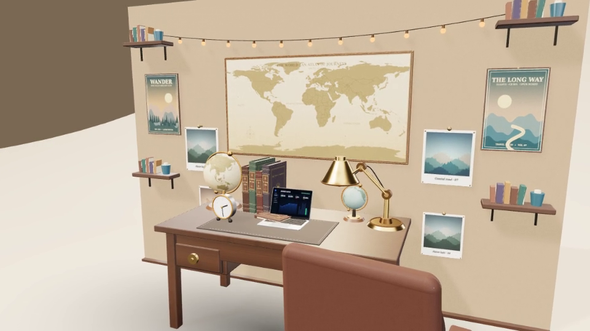
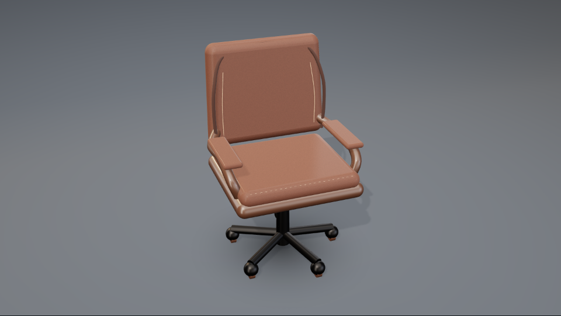
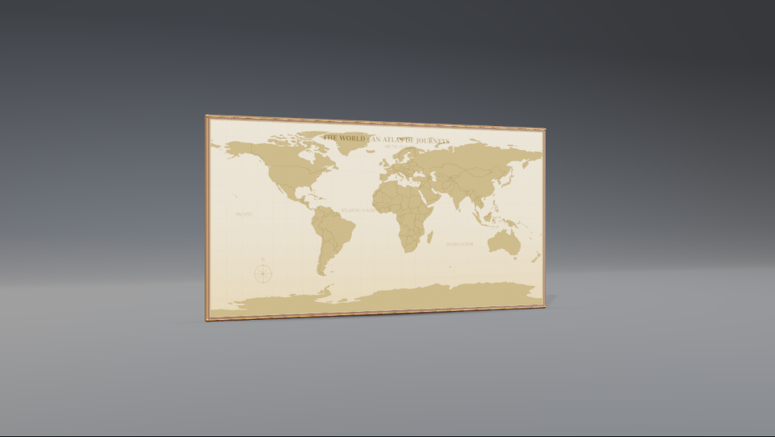
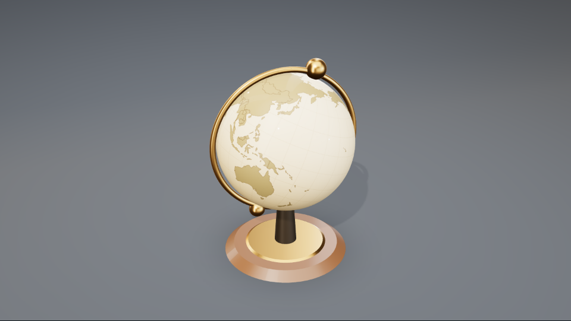
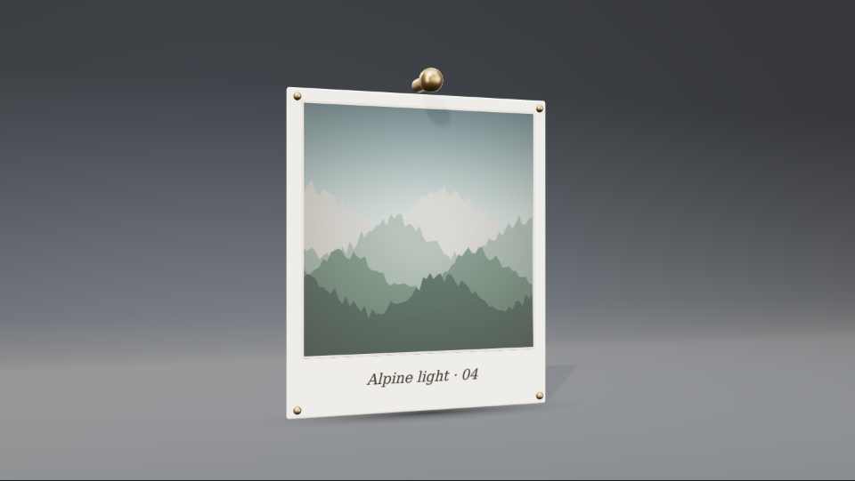
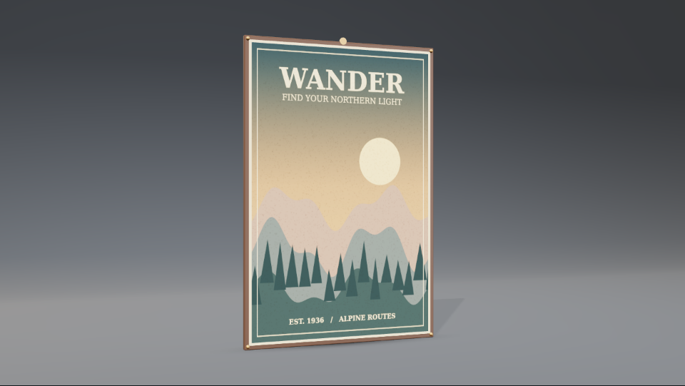
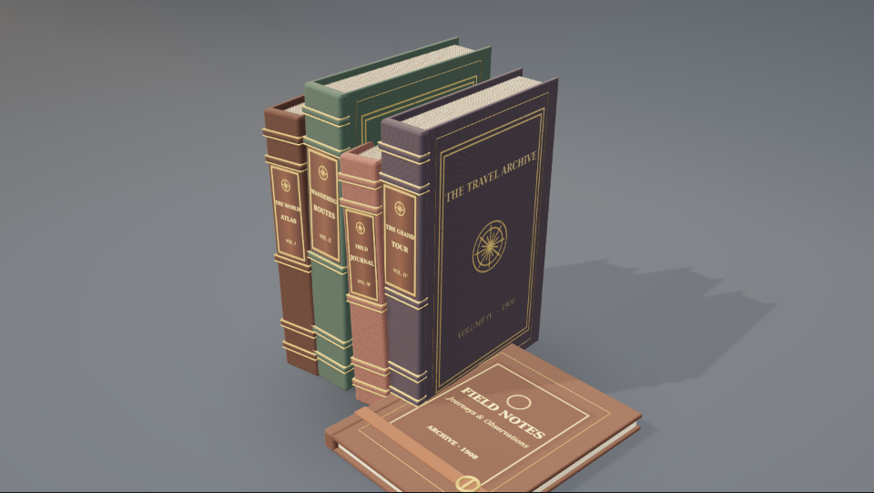
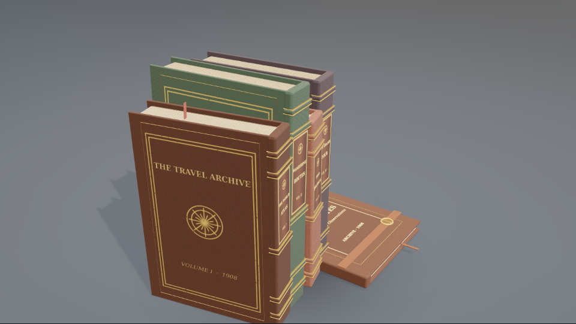
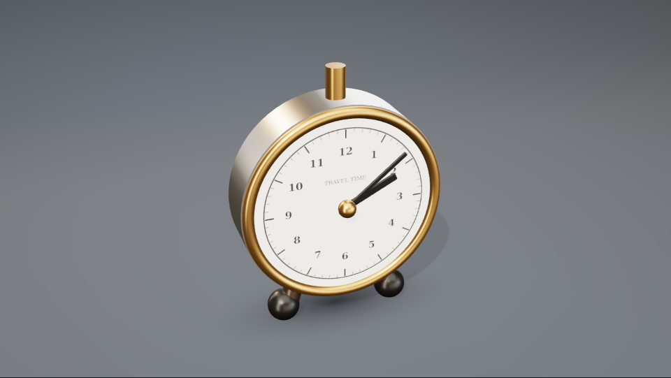
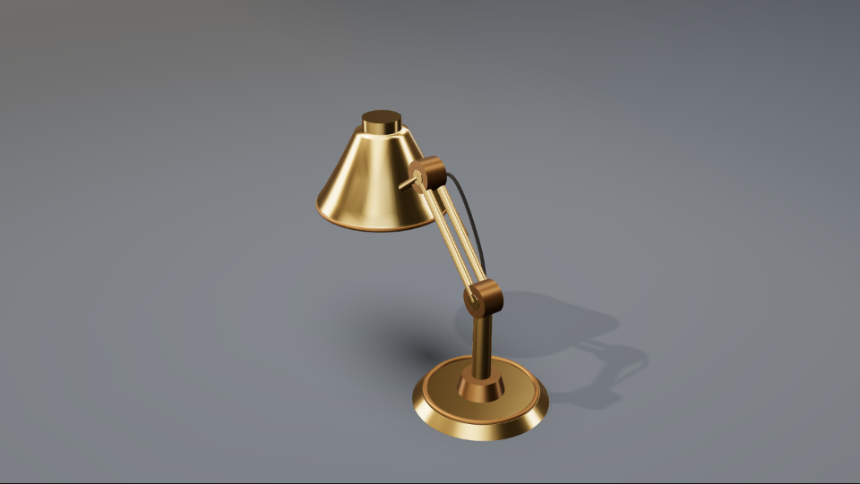

# Travel Study 3D — Visual Craft & Verification

Part of [Premium Everyday 3D / PR #51](https://github.com/YukiUmetsu/kumiki-ui/pull/51). Original geometry and original printed illustrations, inspired by the supplied travel-workspace photograph. The design is a handcrafted miniature set intended for video motion and interactive inspection, **not** a photogrammetric reconstruction or a claim of literal photographic realism.

## The composed room

[Watch the verified five-second Travel Study film](assets/everyday-3d/travel-study.mp4) (960 × 540, 30 fps).

The original photograph's strongest visual hierarchy—large archival atlas, dense personal travel imagery, amber brass, dark walnut, worn leather—is reflected in a small, reusable collection. The laptop is the existing model; every other principal object is newly constructed. Four matted picture prints, two original illustrated travel posters, a catenary of thirteen glowing festoon bulbs, joined walnut shelves with individually bound books and ceramic vessels surround the desk. A later physical-intersection review moved and turned the chair toward the desk while proving it does not clip the top, apron or drawers; the camera preserves the desktop cluster.

## Object craftsmanship

| Isolated render | Modeling and material evidence |
|---|---|
|  | Deep chestnut, pebbled leather and piping; separately shaped seat and back; saddle stitches; bentwood arms; five-spoke castors and iron height piston |
|  | Accurate Natural Earth coast and country paths; 15° graticule; route pins; compass; two-stage matte paper/wood framing with brass inset and physical fasteners |
|  | Textured geography on a 96-segment sphere; independently rotating inclined spindle; 23.5° tilt; graduated brass meridian and turned wooden base |
|  | Original painterly landscape, silver-grain halation, thick mount, handwritten-style caption, four pins and metal spring clip |
|  | Original period letterpress title, illustrated mountain silhouettes, color-separated inks, grain, wooden frame, brass corner tacks and hanging stud |
|  | Four upright, individually sized folios: separate calf/buckram case boards, raised leather sewing bands, 40 gilt fillets, printed spine labels, compass seals, sewn textblocks and visible silk endbands; separate strapped field journal |
|  | Wear-distressed cover foil with ornamental cartographic stamps, physical corner/edge fillets, fine instanced cotton-rag page strata on both head and fore edge, foxing and bookmark ribbons |
|  | Brushed nickel body, enamel dial with sixty graduations and twelve numerals, independent hand pivots, winding crown and little easel feet |
|  | Lathed brushed-brass conical shade with internal enamel reflector; raised base; paired mechanical arms and pivot knuckles; springs, insulated cable and warm local light |

The heritage desk itself is a **standalone stage-set option**, not a replacement for the modern desk: four solid-wood legs, apron joinery, drawers, reveals, brass pulls, edge-rounded 160 × 80 cm top and a saddle-stitched leather desk mat.

### Corrections after watching the encoded film

1. **Flashing atlas/photographs:** The print planes were only about 0.004 set units from their recessed paper backs after composition scaling, while the camera's generic 0.03–800 clip range produced comparable depth-buffer quantization at the room's film distance. The travel camera now uses a much tighter 0.75–180 range, and atlas/photo/poster ink uses a small negative polygon offset. A real Chromium frame-sweep read WebGL pixels across frames 60–72 in three printed regions without abrupt jumps.
2. **Intersecting chair:** The chair's initial floor slot placed its upper back through the desk top. It now faces the table from the foreground and remains physically clear of the desktop and joinery. The regression asserts disjoint world-space bounding boxes, not merely that the screenshot looks acceptable.
3. **Primitive books:** The original horizontal slabs have been replaced by upright, leaning case bindings. The modeled features follow [University of Illinois book anatomy](https://psap.library.illinois.edu/collection-id-guide/bookbound), [Princeton's historical endbands](https://static-prod.lib.princeton.edu/visual_materials/hb/cases/endbands/index.html) and [Library of Congress binding models](https://blogs.loc.gov/loc/2021/05/library-preservation-making-models-of-ancient-books/) as construction references. All artwork and geometry remain original.

#### Encoded-frame flash measurements

After decoding **every frame**, FFmpeg's `signalstats` measured the average luma in the same three fixed regions of both films. Values below are the **largest difference between consecutive frames** (0–255 luma scale), not manually chosen before/after stills.

| Actual encoded-video region | Previous film | Corrected film | Jumps over 10 luma units in corrected film |
|---|---:|---:|---:|
| Large world-map interior | 10.53 | **0.24** | **0** |
| Left pinned photograph | 52.82 | **0.70** | **0** |
| Right pinned photograph | 29.41 | **0.79** | **0** |

The corrected film has 149 consecutive-frame comparisons in each region. Moving camera detail accounts for the small residual variation; the abrupt pattern disappearance is gone. The stage still intentionally shows the edges of a handcrafted miniature room, not a full-scale infinite interior.

## Reusability and film behavior

- `createTravelStudyObject(kind, options)` returns a self-contained, disposable `HeroAsset` with part names, materials and construction notes. Eight kinds are available: `chair`, `world-map`, `globe`, `photograph`, `travel-poster`, `book-stack`, `clock`, `desk-lamp`.
- `createStageSet("desk", { deskStyle: "heritage" })` exposes the desk alone; `createStageSet("travel-study")` supplies the room and named object slots.
- `recipeId: "travel-study"` composes the existing laptop and objects with separate 16:9 and 9:16 camera paths. Seeking is absolute-frame: two globes turn, the articulated lamp adjusts, the clock hands advance, and the laptop opens, with consistent results after backward seeks.
- The geometry and drawings load locally, with no runtime network fetch. Natural Earth's public-domain 1:110m geographic paths are reproduced from `scripts/import-travel-geography.mjs`; the source and usage terms are recorded in `assets/THIRD_PARTY_ASSETS.json`.

## Review notes

Browser review uses Storybook's WebGL capture, not mock raster artwork. Isolated object images above are actual 3D screenshots at independent azimuths; the globe and clock frames are independently seekable. The renderer preserves part-level material variation, but small text and microstitches naturally reduce in a 960 × 540 wide film frame. The photographs/posters are original illustrations rather than the exact user-supplied photos. Camera, mug, ivy and miniatures are not modeled. The repository's separate `hero:quality` check still has **zero owner-approved 3D assets**; this work should remain draft until the owner signs off the intended aesthetic.

### Observed automated verification

- Chromium capture checked that frame 90 differs from the starting frame and reproduces **identical WebGL pixels** after seeking backward and returning. Front and detail screenshots for each of the eight object families rendered without error. The split existing-object gallery also passed. One extra repeated gallery run stalled in browser UI startup; a fresh rerun passed, so a real-browser retry can still be needed in resource-constrained environments.
- TypeScript (`npm run typecheck`), changed-source ESLint, catalog check (**371 entries / 797 stories**), registry validation (**201 entries**) and focused unit tests (**40/40**) passed. The full unit suite was also green earlier in this branch (**2,185 tests**), before the final palette and staging refinement.
- The **entire corrected** `travel-study-capture` film exported through the production FFmpeg pipeline, then independently decoded via `ffprobe`: **150/150 frames, 960 × 540, 30/1 fps, 5.000 seconds**, **810,228 bytes**. SHA-256: `bdc95c6d65fcb6f4c41c16f031a66259baabd98ecc15b21bd0379664ae79f96b`. The exporter used absolute-frame seeking and streamed PNG frames without retaining an intermediate image sequence. A subsequent experimental widening of the stage was discarded after a browser rendering-context error; the committed stage dimensions match this successfully verified film.

